# 打牌体验实验

> **2026-11-14 更新：选定 04 聚光灯，已并入主干。** 演出层在 `src/play/`，回合流程和替身规则在 `src/game/standIn.ts`，对局页是 `/game.html`。并入前按反馈改了三处，这个页面里的 04 也是改过的样子：
>
> - **头条**：把牌拖出手牌就打出，没有第二步确认（十个方案都改了）。
> - **骰子**：从掷骰方一侧抛进来，落地弹两下，顺着前进方向滚，最后翻倒停住；立方体是实心的。
> - **结算时牌不挡视线**：头条两张牌翻开、标出先后之后，缩到左下出牌角上方再开始结算。
>
> 主干里的牌是另一套牌表，它们的事件效果没有写：作为事件打出只会演出这张牌并说明局面不变。这个页面用的仍是原创牌组里的十张，事件是做了的。下面的内容是选型时写的，保留作记录。

一个问题：**打出一张牌的那几十秒，应该怎么演？**

十个方案，同一张实时地图、同一个 HUD（选定的 04 四角）、同一手牌、同一个对手，只比较四件事：

1. **选用途**：事件还是行动，行动里选放置影响力、调整阵营、政变、太空竞赛中的哪一种，每个选项会带来什么。
2. **指目标**：哪些国家可以选，不能选的为什么不能。
3. **掷骰子**：把骰子演出来，而不是只报成败。
4. **看后果**：变化一步一步发生，每一步都把视线带到它落下的地方。核危机变化是最响的那一步。

对手的每一步都走同一套流程，和你的行动对称。

## 十个方案

每个方案三张图：选用途、掷骰、看后果（都是我方在安哥拉政变那一次）。页面里按 `N` 有同样的说明。

### 01 岔路口　<small>基准</small>

| 选用途 | 掷骰 | 看后果 |
|---|---|---|
| 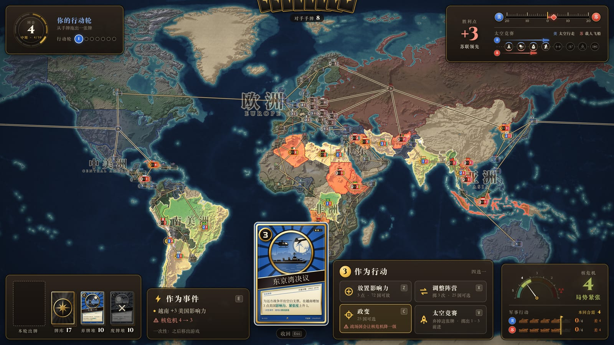 | 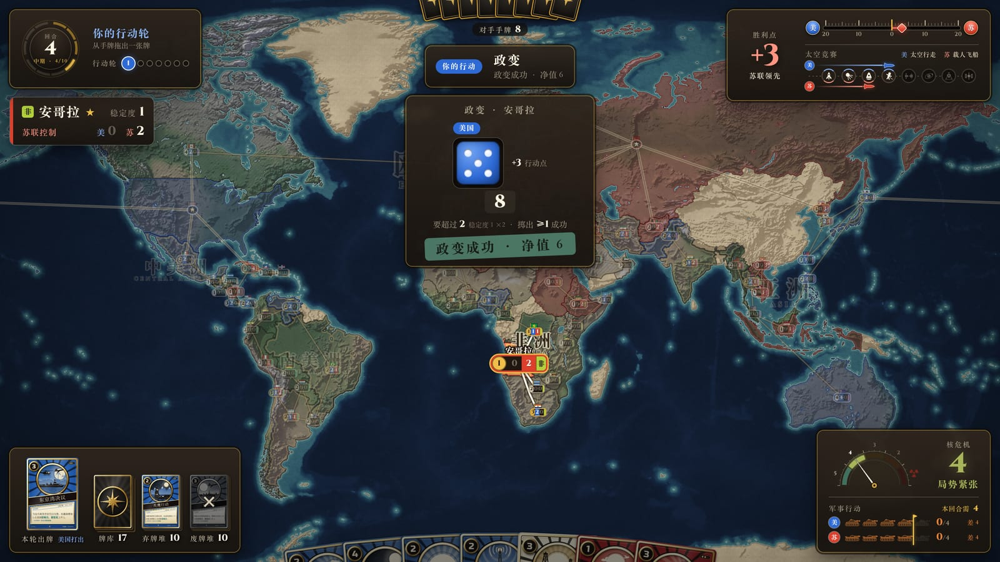 | 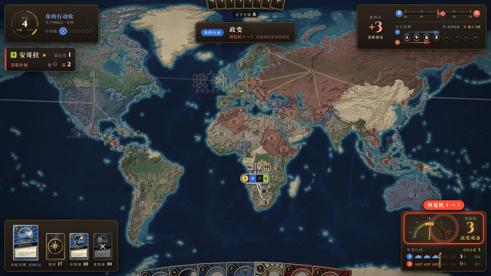 |

- **选用途**：牌停在底部正中，左边一块牌子写事件会发生什么，右边一块是四种行动；指到哪种行动，地图就亮出它能用在哪。
- **指目标**：可选国家亮圈、其余压暗；政变的国家脚下写着所需点数，封锁的地区打锁并说明原因。
- **掷骰子**：顶部骰盘：骰子翻滚落定，列出加值，亮总数，盖“成功 / 失败”章。
- **看后果**：光点从出事的国家飞到刻度，刻度亮框并挂“核危机 4 → 3”。
- **对手行动**：牌先举起来给你读，再走同样的流程；改过的国家留红色数字角标。
- **已知的毛病**：决策托盘占掉底部，这时看不到手里其他牌。

### 02 落点即选择　<small>炉石的拖拽出牌</small>

| 选用途 | 掷骰 | 看后果 |
|---|---|---|
| 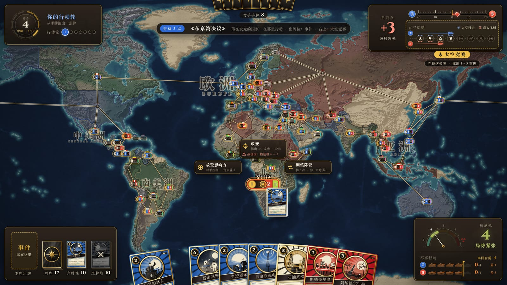 | 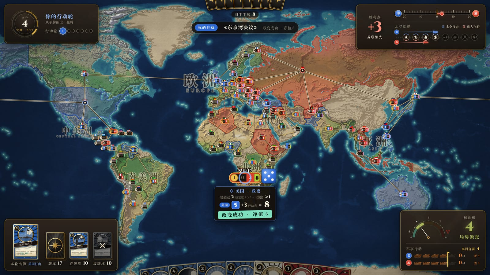 | 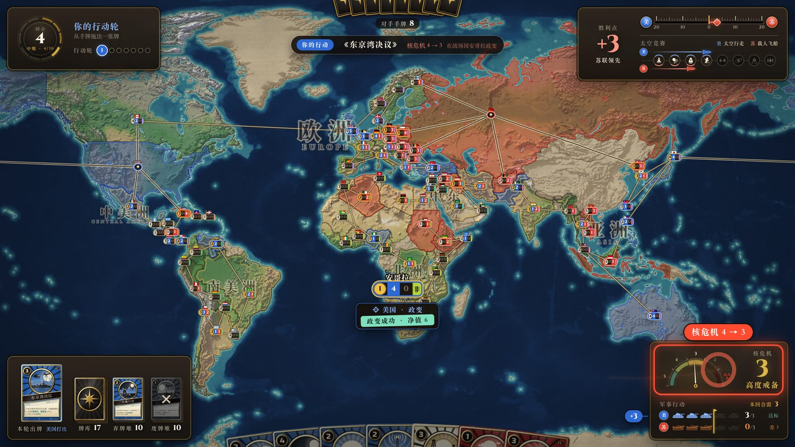 |

- **选用途**：拖着牌时能落的地方全亮：落到国家是在那里行动，落到“本轮出牌”位是事件，落到太空竞赛刻度是太空竞赛。
- **指目标**：先选国家再选动作：落下后国家旁边弹出那里能做的几种行动，带花费、所需点数、战场国警告。
- **掷骰子**：骰子直接掷在地图上那个国家旁边，算式和结果贴在国家下面。
- **看后果**：彗星从国家飞到刻度；刻度旁留一张小纸条直到下一张牌。
- **对手行动**：对手的牌从他手里飞下来“落”在同一个国家上，然后同样掷骰。
- **已知的毛病**：全景下欧洲太密，落点靠“离哪个节点最近”来判断；落到只有一种动作可做的国家会直接执行，不再问。

### 03 行动令　<small>作战命令单</small>

| 选用途 | 掷骰 | 看后果 |
|---|---|---|
| 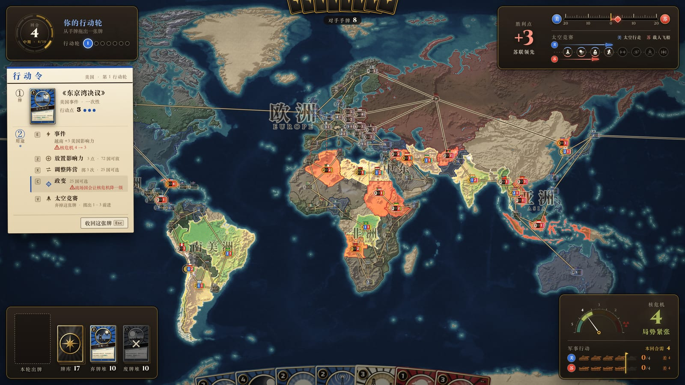 | 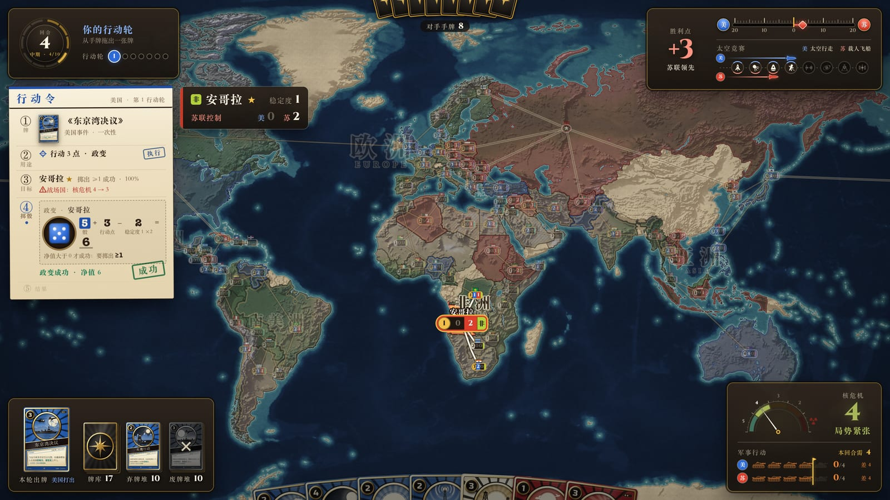 | 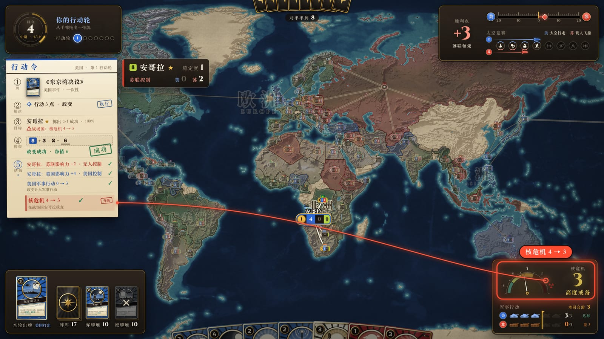 |

- **选用途**：左侧一张羊皮纸，五种用途各占一行，写明后果，不能用的划掉并写原因；选中的盖章。
- **指目标**：目标先用“铅笔”写（悬停），点了才变成墨水；放置是一行流水账。
- **掷骰子**：骰盅嵌在纸里，算式逐项写出：骰 5 + 行动点 3 − 稳定度 1×2 = 6。
- **看后果**：每条结果打勾时拉一根线到国家或刻度；核危机那行是红的，盖“升级”章。
- **对手行动**：红头的“苏联行动令”逐行打出，折起来留到你出下一张牌。
- **已知的毛病**：行数多的时候纸内部滚动。

### 04 聚光灯　<small>电影镜头</small>

| 选用途 | 掷骰 | 看后果 |
|---|---|---|
| 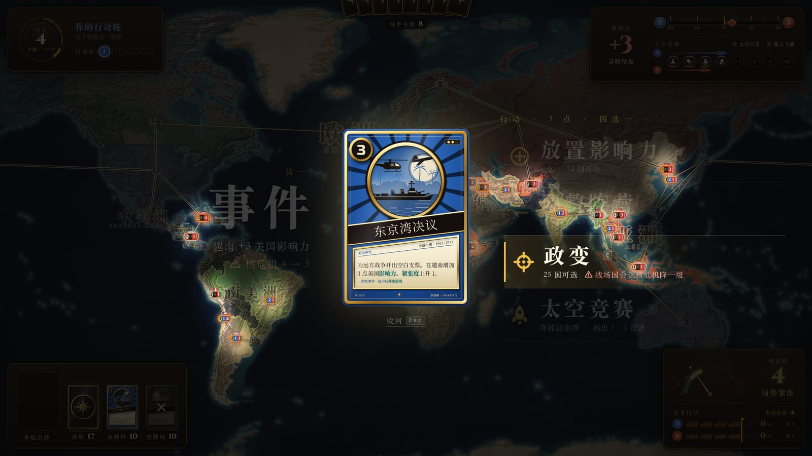 | 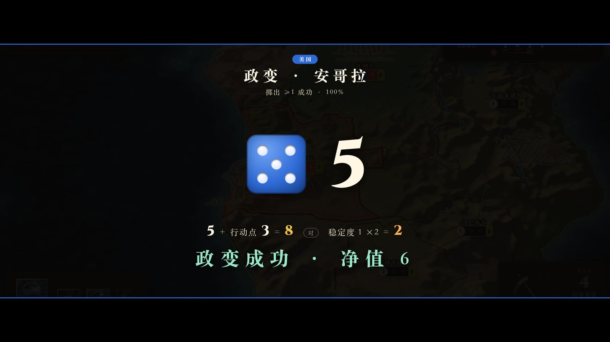 | 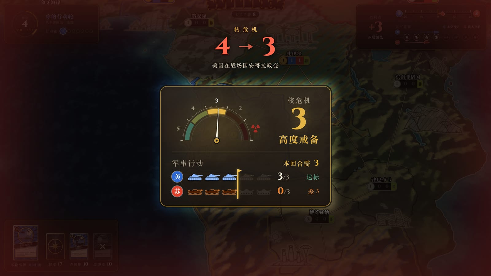 |

- **选用途**：牌升到中央，屏幕一分为二：左半“事件”，右半“行动”，都是大字；选行动后右半变成四条。
- **指目标**：地图罩一层暗幕，只有可选国家是一汪光；一行字幕说明要你做什么。
- **掷骰子**：上下遮幅合拢，一颗 14rem 的大骰子在正中，最后半圈放慢，落定时全屏一震。
- **看后果**：刻度自己走到屏幕中央：整块面板从角落飞来放大，指针在你面前走一格，再回去。
- **对手行动**：先出一张红色标题卡“苏联 · 政变 · 扎伊尔”，之后同样的镜头。
- **已知的毛病**：演出期间 HUD 四角是压暗的；每个刻度变化都要等面板飞一个来回。

### 05 指令环　<small>轮盘菜单</small>

| 选用途 | 掷骰 | 看后果 |
|---|---|---|
| 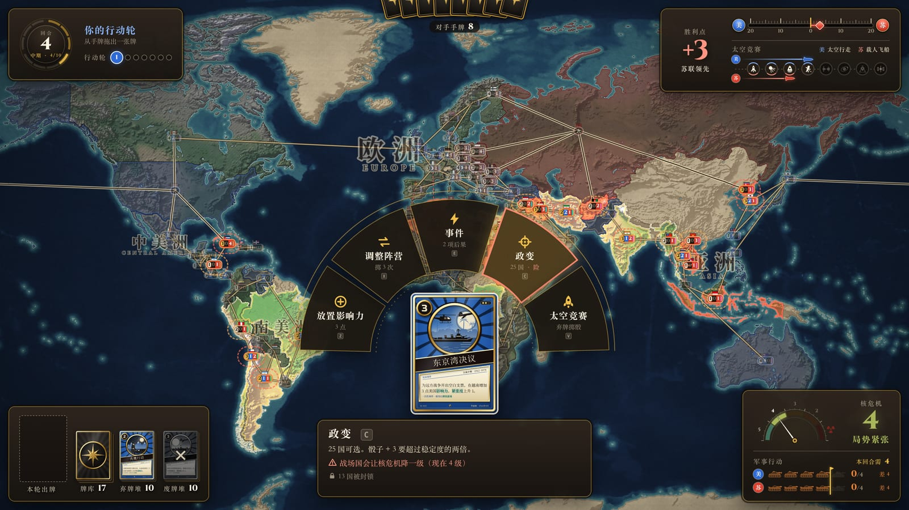 | 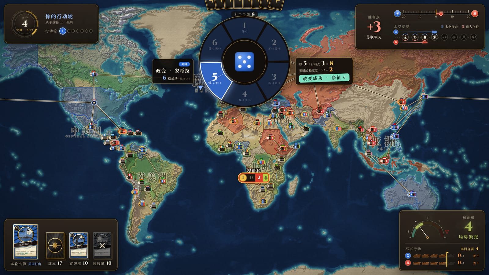 | 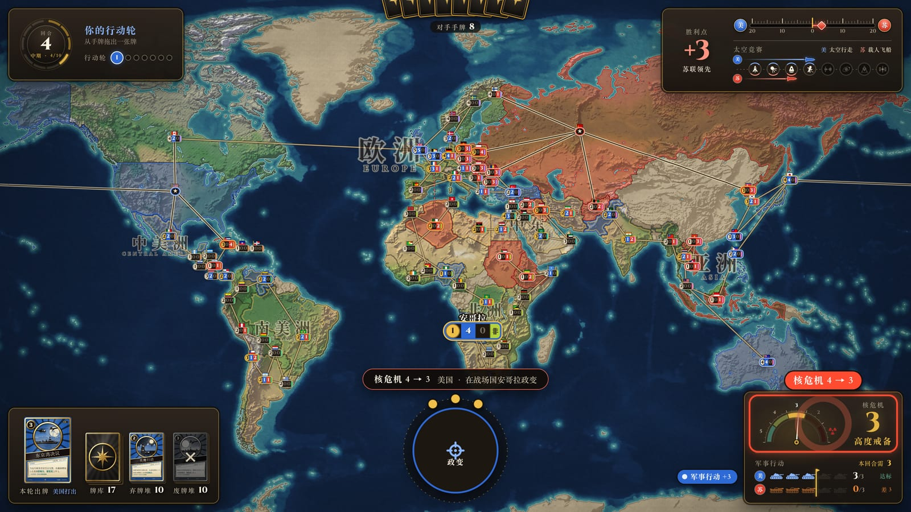 |

- **选用途**：五片花瓣绕着牌展开，指到哪片，牌下的小牌子写明细节。
- **指目标**：底部一个小转盘：动词在中间，点数是环上的珠子。
- **掷骰子**：掷骰前先亮出六格转盘，哪几格成功、每格发生什么都写着；指针绕盘一圈停下。
- **看后果**：每个后果是一颗珠子，从转盘飞到国家或刻度。
- **对手行动**：顶部一只红色的环，镜像地做同样的事。
- **已知的毛病**：转盘指针固定转 2.3 秒，不跟速度设置，空格跳不过；目标国家会被挡住时转盘换到屏幕另一头。

### 06 电传打字机　<small>电报纸带</small>

| 选用途 | 掷骰 | 看后果 |
|---|---|---|
| 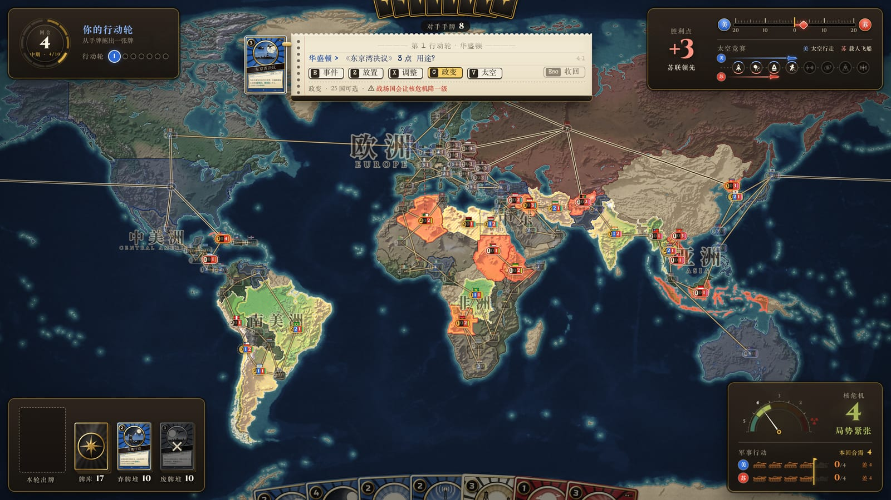 | 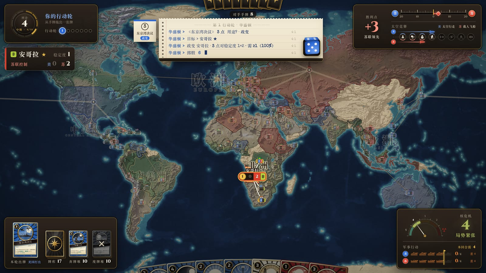 | 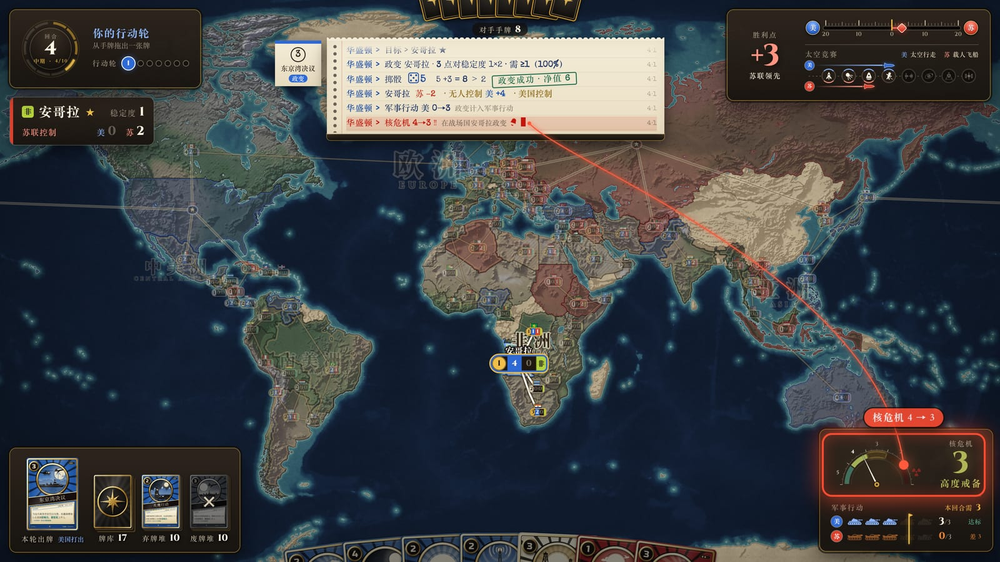 |

- **选用途**：纸带上打出一行提问和一排键帽 E / Z / X / C / V，指到键帽就多打一行解释。
- **指目标**：国家旁边挂代号纸签，敲代号也能选；放置是一行越写越长的电文。
- **掷骰子**：行内一排数字像字轮一样乱跳后停住，纸带末端同时有一颗真骰子。
- **看后果**：每个后果一行，从这一行牵一根线到国家或刻度；核危机那行是红的，响铃，纸带一颤。
- **对手行动**：同一条纸带，红字，抬头“莫斯科 >”，行的顺序完全一样；纸带就是记录。
- **已知的毛病**：行动进行中纸带长到六行，会盖住北欧几个节点；头条翻牌沿用基准方案的。

### 07 筹码与骰盅　<small>实体桌游的手感</small>

| 选用途 | 掷骰 | 看后果 |
|---|---|---|
| 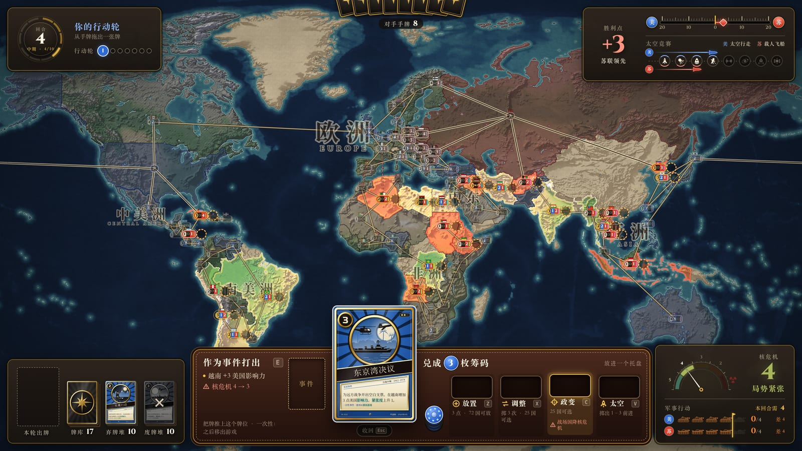 | 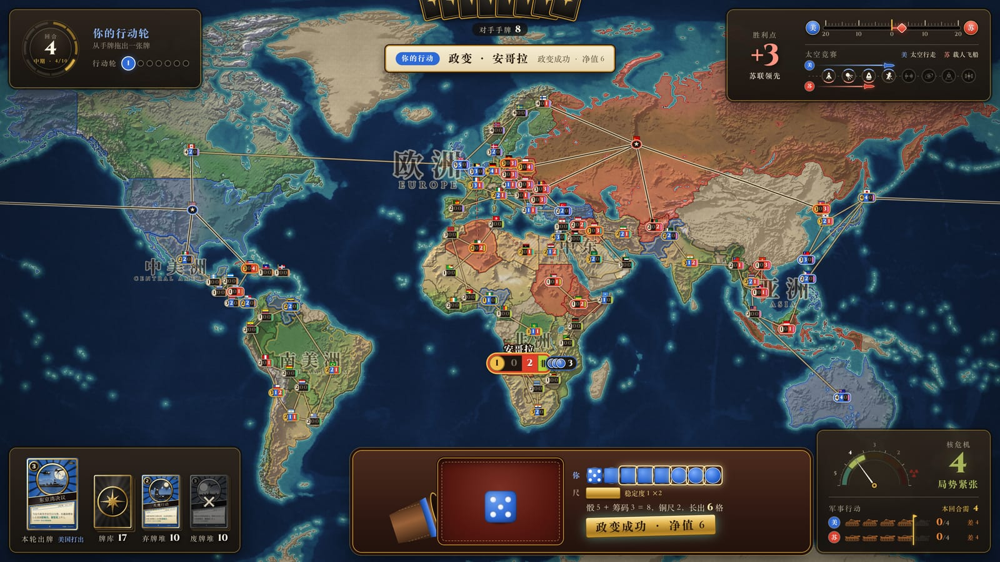 | 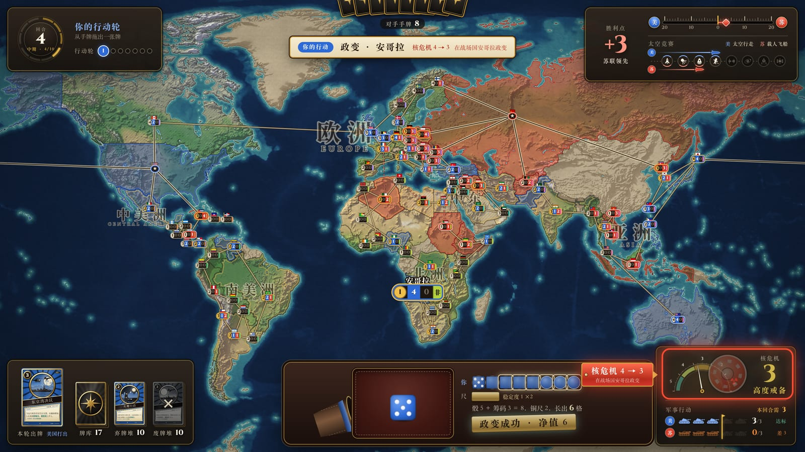 |

- **选用途**：牌的点数兑成一叠蓝筹码，后面四个小托盘是四种行动；事件是把牌推上桌。
- **指目标**：放置是把筹码拖到国家上（点国家也行），对手控制的国家吃两枚；政变是整叠压上去。
- **掷骰子**：按住骰盅摇，越久越响，松手掷出；骰子点数和筹码排成一排，对着一根铜尺比长短。
- **看后果**：失去的影响力是筹码被打落，得到的是筹码落下；刻度变化是一枚硬币划弧线飞过去，盖一块铜牌。
- **对手行动**：红筹码从他手里一枚一枚落到国家上；他的骰盅在顶部摇。
- **已知的毛病**：头条翻牌沿用基准方案的；动画时长不跟速度设置（等待会跟）。

### 08 因果链　<small>一句话写完一次出牌</small>

| 选用途 | 掷骰 | 看后果 |
|---|---|---|
| 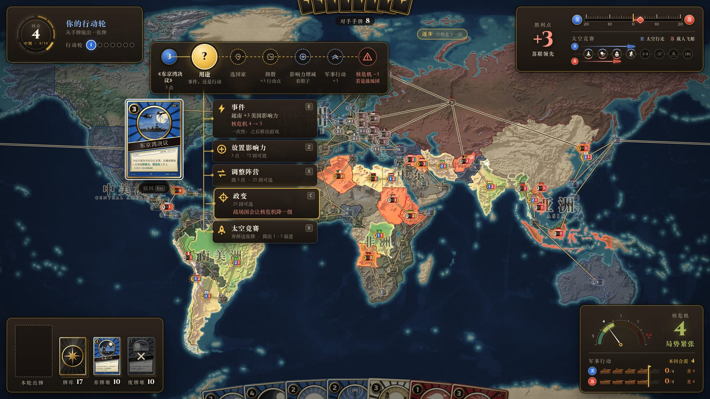 | 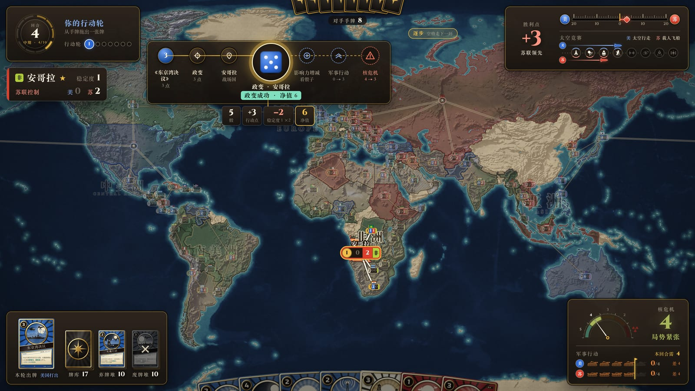 | 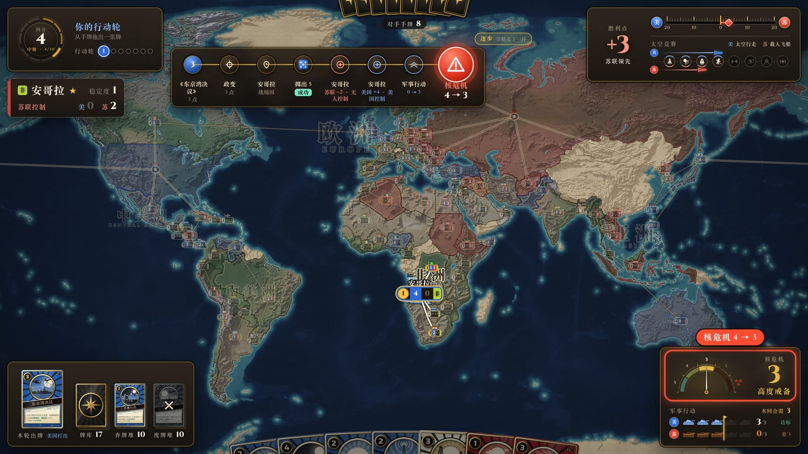 |

- **选用途**：顶部一串圆章：牌 → 用途 → 目标 → 骰 → 后果；第二环向下分出五条枝。
- **指目标**：还没掷骰，后面的环已经以虚影排好（军事行动 +3、核危机 4→3）。
- **掷骰子**：骰子在“骰”那一环里翻滚，加减项一块一块接上去。
- **看后果**：每一环依次点亮并射出一道光指向它改的地方；可切到“逐步”，按一次空格走一环。
- **对手行动**：同一位置长出一条红链；上一手的链缩成一条细带留着。
- **已知的毛病**：一条链超过九环时最早的几环缩成小珠（没有在画面上验证过）；事件的虚影环和实际后果不一定一一对应。

### 09 沙盘推演　<small>先看推演再决定</small>

| 选用途 | 掷骰 | 看后果 |
|---|---|---|
| 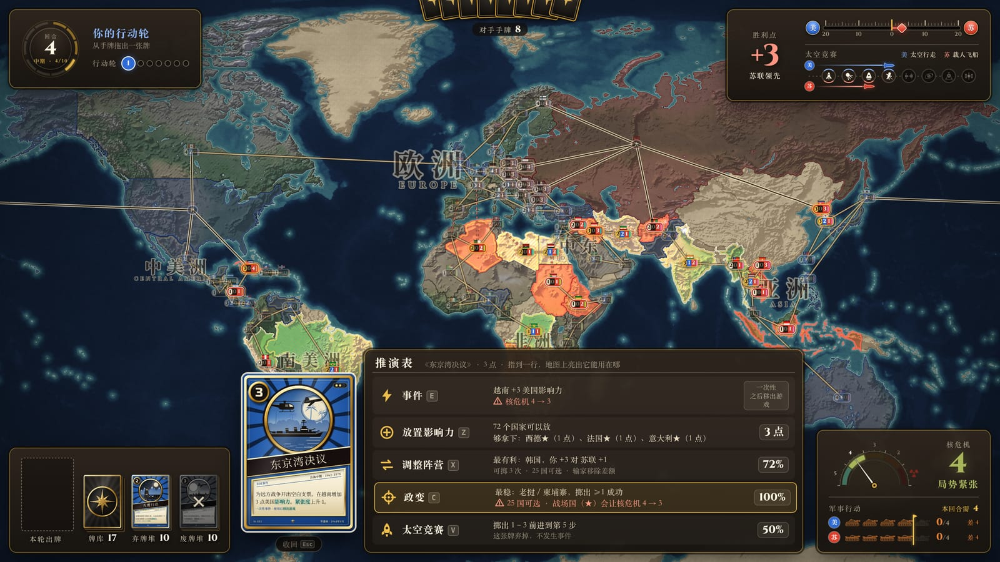 | 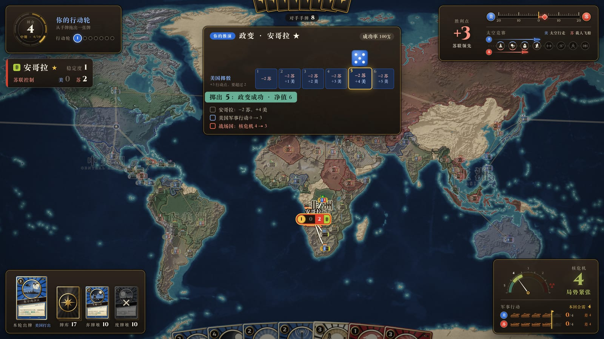 | 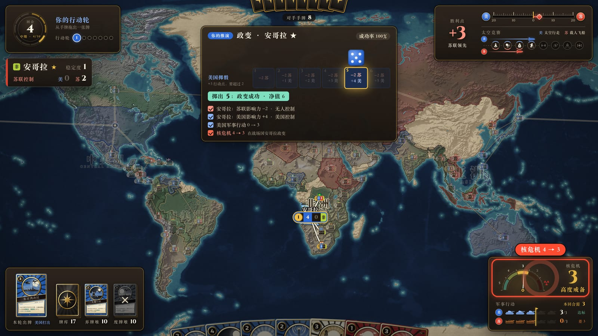 |

- **选用途**：一张推演表：五种用法各会怎样，现算（事件对谁有利、政变最稳的目标和成功率……）。
- **指目标**：指到一个国家，旁边弹出推演卡：骰子 1–6 各会发生什么排成六格，下面列必然的副作用。
- **掷骰子**：骰子沿那六格跳，停在哪格就执行哪格，不用看算式。
- **看后果**：预告过的后果是一张清单，发生一条打一个勾，同时有光点飞到对应位置。
- **对手行动**：对手行动前，同一张推演卡以红色出现在他的目标上，让你带着同样的理解看他掷骰。
- **已知的毛病**：推演卡在拥挤地区会盖住旁边的节点；事件的预告行和实际后果不一定一一对应。

### 10 对局桌　<small>两人对坐，落子留痕</small>

| 选用途 | 掷骰 | 看后果 |
|---|---|---|
| 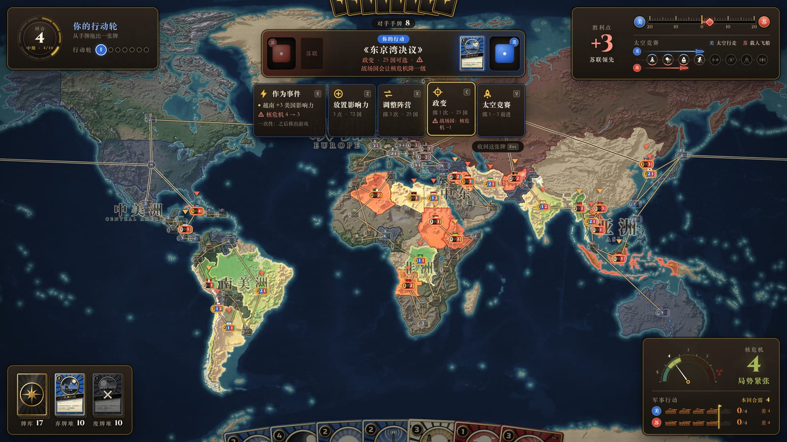 | 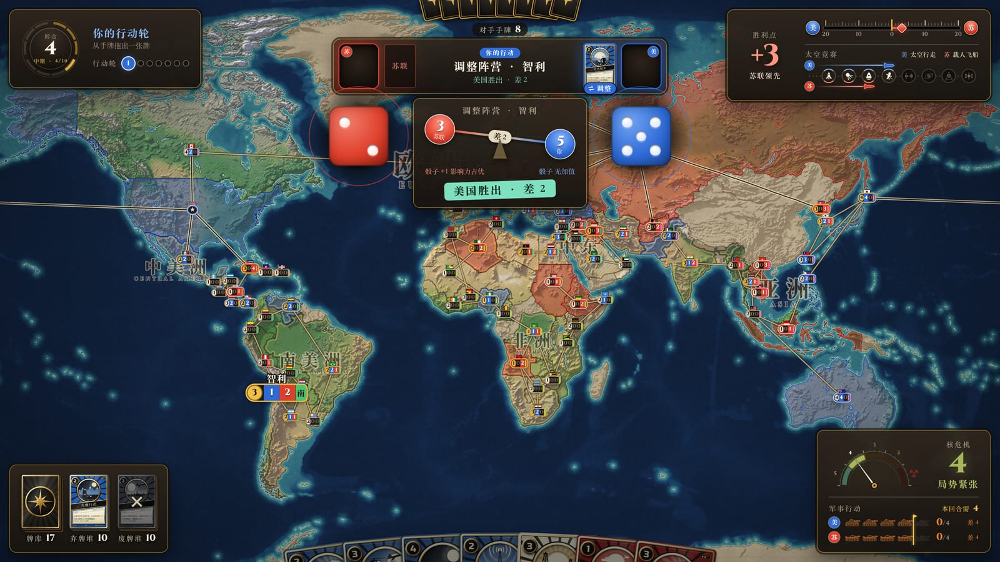 | 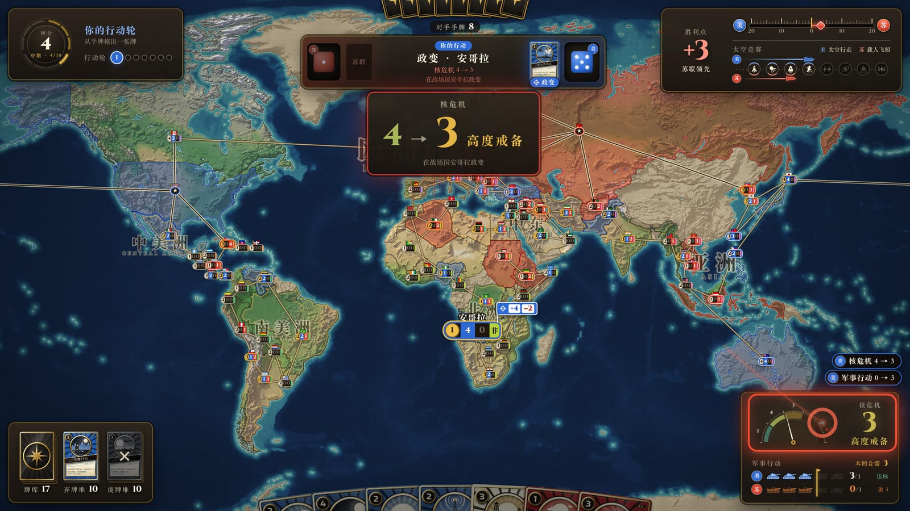 |

- **选用途**：顶部一张桌子，你和苏联各一个牌位；牌进了你的牌位，下面展开五枚选项。
- **指目标**：可选国家头顶挂一个小箭头；两席之间的牌子说明要你做什么。
- **掷骰子**：每席一口骰井；调整阵营时两口同时掷，中间的牌子变成一杆秤，偏向点数高的一方。
- **看后果**：每个行动在出事的国家插一面小旗（动词图标 + 净变化），刻度旁留一张带阵营色的签，整轮都在。
- **对手行动**：同一套家具：他的牌位下也展开五枚选项、亮起他选的那枚；“上一手”可以重放。
- **已知的毛病**：桌子常驻顶部正中，平移到它下面的国家点不到；全景下欧洲的小旗会挤在一起。

## “变化怎么指给人看”：十个方案里其实是六种手法

你说这一点想一起想想。把十个方案拆开看，用到的手法是这六种，各自解决的问题不一样：

| 手法 | 哪些方案 | 解决什么 | 代价 |
|---|---|---|---|
| **光点连线**：从出事的地方飞到变化的刻度 | 01 02 05 07 08 | 把“因”和“果”连起来，视线被带着走 | 只有半秒，眨眼就错过，必须配一个停留的标签 |
| **把刻度请到面前**：面板飞到屏幕中央，在你眼前变 | 04 | 不可能看漏 | 慢；每次变化都这样会烦 |
| **事先预告**：选之前就写明“这会让核危机降一级” | 08 09，01 的托盘和悬停提示也有一点 | 变化不再是意外，事后只需要确认 | 对自己的行动有效；对手的行动要另想办法（09 的做法是先把他的推演卡亮出来） |
| **留痕**：变化之后留一个角标、小旗、标签，直到你下一次行动 | 10 最彻底，01 02 03 也有 | “我刚才没看”的情况；对手行动之后尤其重要 | 留多了会脏；要定好什么时候清掉 |
| **文字记录**：每个变化一行字，可以回看 | 03 06，08 的链也算 | 可以重读、可以核对 | 占地方；要读 |
| **节奏**：一次只演一个变化，中间停一拍，可以跳过 | 全部 | 不会几件事同时变 | 熟手嫌慢，所以要有空格和速度档 |

我的看法（只是判断，手感要你自己玩过才知道）：

- **默认用“光点 + 留痕”**：每个变化都有光点带路，落点留一个带阵营色的标签，到你下一次出牌时清掉。便宜，不打断节奏。
- **“请到面前”只留给核危机**（以及以后别的能直接输掉游戏的变化）。它是最重的一招，稀有才有分量。
- **“预告”放进选择界面**：选之前就把后果写出来，尤其是 09 那条六格骰子带，它让“骰子掷出几会怎样”不用算。
- **对手的行动一定要留痕**。他动的时候你可能在看别处，10 的小旗和签是目前最稳妥的答案。

## 如果要我选

单选一个的话我选 **09 沙盘推演**：它最直接地回答了“机制复杂也能轻松带着走”，掷骰之前你就知道每个点数意味着什么。它的弱点是字多，紧张感不如 04 和 07。

更可能的结果是拼一个：

- **骨架用 01**（牌居中、事件和行动左右摆开、悬停即预览），它最不需要学。
- **选目标和掷骰用 09**（推演卡和六格骰子带）。
- **核危机变化用 04**（面板飞到中央），其余变化用光点。
- **对手的行动加上 10 的留痕**（小旗和标签）。
- **02 的“拖到国家上”** 可以作为熟手的快捷方式叠在上面，不替代托盘。

07 的摇骰盅手感最好，但它和 09 的骰子带是两种骰子，只能留一种；如果你更看重“紧张刺激”而不是“看得懂”，就把 09 的骰子换成 07 的。


## 怎么看

```sh
npm run dev
# 打开 http://localhost:5173/prototypes/card-play/
```

需要开发服务器，因为它直接引用 `src/map` 的地图模块和 `prototypes/hud-layouts` 的 HUD（都是只读引用）。

| 操作 | 作用 |
|---|---|
| `1`–`9`、`0`，或 `←` `→`，或点顶栏 | 切换方案（每次切换从头开始） |
| `R` | 从头条阶段重来 |
| `O` | 跳过头条，从对手的第一个行动开始 |
| `A` | 跳过头条和对手，直接轮到你 |
| `空格` | 跳过当前这一拍的等待 |
| `P` | 演出速度：常速 / 快 / 慢 |
| `N` | 当前方案的说明：四件事各怎么做、好处、代价 |
| `F` | 隐藏顶部工具栏，只看游戏画面 |

选牌之后的按键各方案基本一致：`E` 事件，`Z` 放置影响力，`X` 调整阵营，`C` 政变，`V` 太空竞赛，`↵` 确认，`⌫` 撤销一步，`Esc` 收回这张牌。

网址参数：`?v=3` 直接打开第 3 个；`&from=action`（或 `opponent`、`headline`）从哪开始；`&dice=5,2,6` 指定接下来几次骰子的点数；`&pace=0.5` 整体加速一倍；`&clean=1` 不带工具栏。

## 演的是什么

第 4 回合，一个编出来的局面（`core/situation.js`），不是任何现成的开局。

- **头条阶段**：把一张牌拖出手牌，松手就打出，没有第二步确认（十个方案都一样）。拖着的时候，提示处会写出这张牌的事件要做什么；只是单击一下不会出牌，牌上方会冒出一句“拖出来，松手就打出”。对手出《上升号》。同时翻开，数值高的先结算，平手你先。
- **行动轮**：每轮对手先动，然后轮到你。对手的七步是写死的脚本，为的是让每种行动都从对面演一遍；只有骰子是随机的。

| 轮次 | 对手做什么 |
|---|---|
| 1 | 《兄弟援助》3 点，放置影响力：泰国 +2、意大利 +1 |
| 2 | 《自由军官》2 点，在扎伊尔政变（战场国，核危机会降一级） |
| 3 | 《友好条约》2 点，在阿根廷调整阵营两次 |
| 4 | 《谷物大采购》太空竞赛 |
| 5 | 《旅伴》作为事件 |
| 6 | 《春节攻势》3 点，在索马里政变 |
| 7 | 《印苏亲如兄弟》2 点，放置影响力：埃及 +1、巴西 +1 |

你手里的八张牌各有用意：

| 牌 | 点数 | 用来看什么 |
|---|---|---|
| 《我是柏林人》 | 2 | 最简单的事件：一个国家加影响力，再加 1 胜利点 |
| 《东京湾决议》 | 3 | 事件本身会让核危机降一级 |
| 《静海基地》 | 4 | 事件值 3 胜利点，行动值 4 点：一个真的两难 |
| 《奇迹稻米》 | 2 | 事件同时落在三个国家 |
| 《自由欧洲电台》 | 2 | 事件需要你点三个国家 |
| 《石油武器》 | 3 | 中立事件，谁得利要现算（当前对苏联有利） |
| 《斯德哥尔摩呼吁》 | 1 | 对手的牌：拿它行动，事件照样发生；点数太小，进不了太空竞赛 |
| 《阿纳德尔行动》 | 3 | 对手的牌，事件让核危机连降两级：只有太空竞赛能躲开 |

## 哪些是真的，哪些是占位

- **地图、HUD、牌面** 都是现有的：`src/map` 的地图、04 四角布局和它的精细刻度、`prototypes/card-designs/deck` 的原创牌组。
- **规则是替身**（`core/rules.js`），只为让选择有真实的后果，数值都要换成游戏自己的：
  - 放置影响力：已有影响力的国家及其邻国可放，对手控制的国家每点花 2。
  - 政变：骰子 + 行动点，超过稳定度的两倍才成功；超出的部分先移除对手影响力，再加自己的。在战场国政变，核危机降一级。行动点计入军事行动。
  - 调整阵营：双方各掷一颗，加上相邻受控国数、毗邻本土、影响力占优；低的一方移除差额。
  - 太空竞赛：牌至少 2 点，每回合一次，掷出 1–3 前进一步，不触发对手事件。
  - 地区封锁：核危机 4 级及以下欧洲禁止政变和调整阵营，3 级及以下亚洲，2 级及以下中东。核危机到 2 级时战场国不能再政变。
  - 控制：一方影响力领先达到稳定度。
- **事件只做了出现的这十张**（你的八张和对手用作事件的两张），写在 `core/rules.js` 末尾。
- **没做的**：结算牌、回合结束、军事行动不足的惩罚、抽牌。

## 文件

```
index.html  main.js      页面、舞台（04 布局）、工具栏、方案切换
core/situation.js        演示用的局面、你的手牌、对手的脚本
core/rules.js            规则替身：谁能在哪做什么、掷骰结果、十张牌的事件
core/game.js             状态和“导演”：按顺序走完头条和行动轮，每一步交给当前方案去演
core/base.js             方案要回答的十一件事，以及一套朴素的默认演法（也就是 01）
core/board.js            地图接口：标出可选国家、点选、国家上的数字 / 光圈 / 角标、镜头
core/hand.js             手牌：扇形、悬停放大、点击或拖出
core/dice.js             一颗真的立方体骰子
core/fx.js               光点、亮框、遮罩、横幅、可跳过的等待
core/core.css            以上这些的样子
variants/NN-name.js/.css 一个方案：只写它和默认演法不同的部分
shots/                   每个方案三张截图：选用途、掷骰、看后果
```

一个方案就是一个“演法”对象。导演（`core/game.js`）决定发生什么、按什么顺序；方案决定怎么问、怎么演。
双方的行动走的是同一组调用（`play.by` 是 0 还是 1），所以一个方案给自己的行动做了什么指引，对手的行动自动也有。
