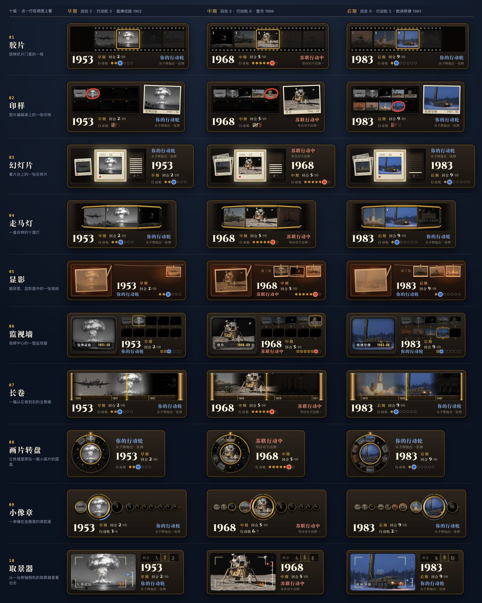
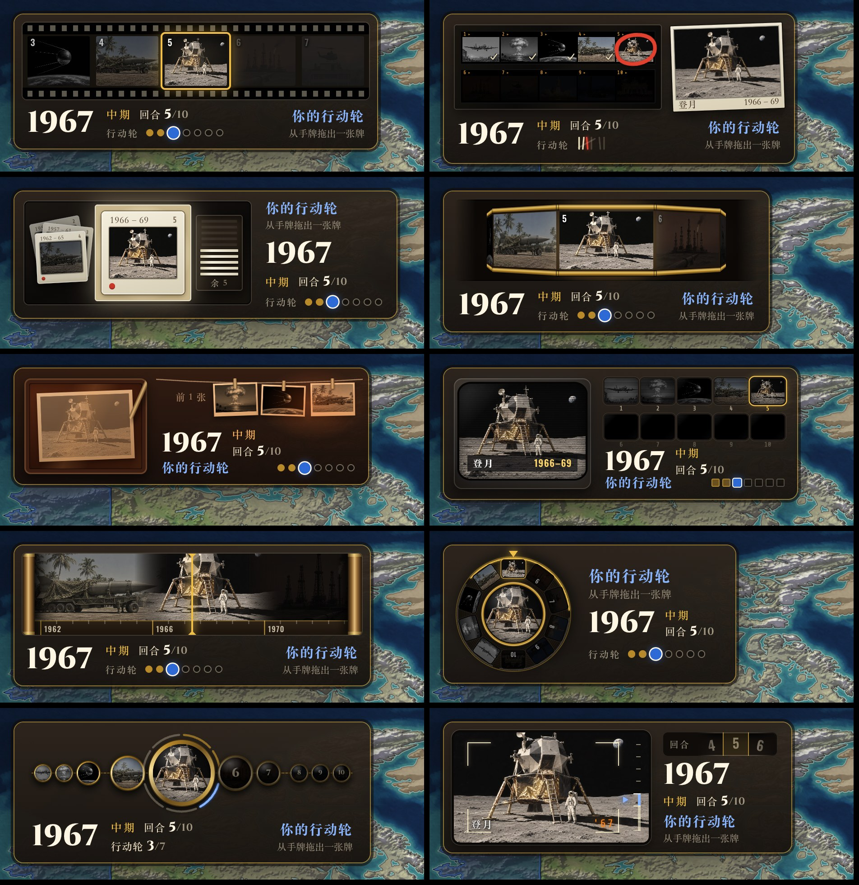
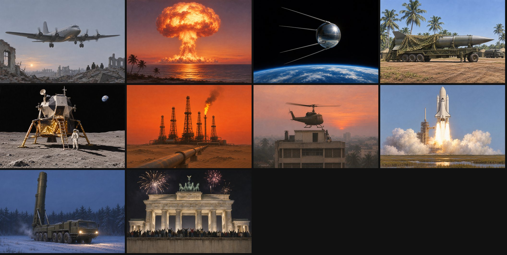

# 年代画面实验

一个问题：**左上角那一块（回合、时期、行动轮、谁行动），怎么让人一眼看出“现在是哪个年代”，并且有代入感？**

上一轮的十种（`prototypes/year-styles`）被否了：没有代入感。留下来的只有“胶片”那一组的思路。这一轮按两条要求重做：

1. **不同年代有不同的画面，画风写实。** 每个回合一张写实的画，画的是那几年的一件事（十张，见下）。
2. **以胶片为灵感。** 胶片好在哪：十个回合是一件实物上的十幅画，当前这幅在焦点里，过去和将来分得清。这一轮的十组都是“载着这十幅画的一件东西”，胶片是第一组，另外九组是九个不同的东西。



放到地图左上角的样子（都是第 5 回合第 3 行动轮）：



## 怎么看

```sh
npm run dev
# 打开 http://localhost:5173/prototypes/era-pictures/?g=1
```

| 操作 | 作用 |
|---|---|
| `1`–`9`、`0`，或 `←` `→` | 换一组 |
| `空格`，或点一下面板 | 走一个行动轮（最后一轮之后进入下一回合） |
| `]` / `[` | 下一回合 / 上一回合 |
| `S` | 换成对手行动 / 换回你 |
| `P` | 行动轮 / 头条阶段 / 回合结算 |
| `G` | 总览：十组一起看，各取早期、中期、后期的一刻；点一行回到地图上看它 |
| `N` | 当前这组的说明：怎么读、好处、代价 |
| `F` | 隐藏顶部工具栏 |

`?v=3` 直接打开第 3 组，`?g=1` 打开总览，`?t=8&r=2` 从第 8 回合第 2 行动轮开始，`&s=1` 对手行动，`&clean=1` 不带工具栏。

每组换回合时都有自己的动作（胶片走一格、走马灯转一面、快门一闪……），值得按几下 `]`。

舞台是主干现在的对局画面：`src/hud` 的 HUD 和实时地图原样引入，只把左上角面板里的内容换掉。`src/` 一个字没改。

## 十张画



| 回合 | 年份 | 画面 | | 回合 | 年份 | 画面 |
|---|---|---|---|---|---|---|
| 1 | 1945–50 | 柏林空运 | | 6 | 1970–73 | 石油危机 |
| 2 | 1951–56 | 氢弹试验 | | 7 | 1974–78 | 西贡撤离 |
| 3 | 1957–61 | 第一颗卫星 | | 8 | 1979–82 | 航天飞机 |
| 4 | 1962–65 | 导弹危机 | | 9 | 1983–86 | 欧洲导弹 |
| 5 | 1966–69 | 登月 | | 10 | 1987–91 | 柏林墙倒 |

- 画是用 Codex 的图片生成工具做的，提示词在 [`img/README.md`](img/README.md)。没有人物肖像，没有文字和标志。
- **哪件事代表哪个回合是我先挑的**，回合对应哪几年也沿用上一轮的初稿（3 / 4 / 3 个回合铺在 1945–1991 上）。都等你定。
- 除了每回合一张画，时期之间还有一层“质感”的区别：**早期是黑白的，中期是褪色的彩色，后期是鲜艳的彩色**。同一张画过一遍滤镜，不是另画的。05 显影在安全灯下全是单色，09 小像章保留原色，这两组没有用这一层。

## 十组

| # | 名字 | 是什么东西 | 当前回合 | 过去 / 将来 | 行动轮 |
|---|---|---|---|---|---|
| 01 | 胶片 | 放映机片门里的一条胶片 | 片门里那一格 | 左边暗下去 / 右边没曝光 | 一排圆点 |
| 02 | 印样 | 图片编辑桌上的印样，加一张放大的照片 | 红蜡笔圈住的那格，旁边是它的放大 | 打了勾 / 黑的 | 蜡笔计数道 |
| 03 | 幻灯片 | 看片台上的反转片 | 亮格上透光的那张 | 左边一摞 / 右边片盒里 | 一排圆点 |
| 04 | 走马灯 | 一盏从里面亮着的十面灯 | 正对你的那一面 | 转到左边 / 右边暗处 | 一排圆点 |
| 05 | 显影 | 暗房的显影盘和晾片绳 | 盘里正在显影的那张 | 绳子上晾着 / 还没有 | **画面显出来多少** |
| 06 | 监视墙 | 指挥中心的一面监视器 | 主屏，小墙上金框那台 | 还亮着 / 没开机 | 控制台方灯 |
| 07 | 长卷 | 两根轴之间的一幅全景画 | 金线压着的那一段 | 卷在左轴 / 还在右轴 | **金线在这一段里走了多远** |
| 08 | 画片转盘 | 现在的回合转盘，盘沿换成小画片 | 指针下那张，盘心放大 | 盘沿上亮的 / 暗的 | 一排圆点（同主干） |
| 09 | 小像章 | 一串金圈微型画 | 放大到跟前的那枚 | 越远越小 / 蒙着 | **大圆外的一圈弧线** |
| 10 | 取景器 | 从旁轴相机里看出去 | 整个取景器 | 看不到 | 取景器右沿的测光刻度 |

每组的读法、好处和代价在页面里按 `N` 看，也写在各自 `variants/NN-*.js` 的开头。

## 我的看法

先说取舍的轴：**画面要大**（写实的画小了就只是色块）和**十个回合都在场**（进度一眼可见）是互相挤的。十组在这条轴上的位置不同。

- **01 胶片** 仍然是最稳的：你已经认可了它的结构，这一轮只把画换成写实的、加了三个时期的片种区别。代价是画面最小的一档。
- **07 长卷** 是我这一轮最想推荐的一个新思路：它是唯一让时间连续走的，每个行动轮画面都在挪，而且画面互相融在一起，比十个小格更像“一段历史”。
- **09 小像章** 最直接地回答了“每个年代一个图标”，材质也和其它三个角最统一。
- **08 画片转盘** 改动最小：就是现在的转盘换了芯，占地和布局不变，并进主干最省事。
- **10 取景器** 画面最大、代入感最强，但放弃了进度感。**05 显影** 最有戏（行动轮是看着画面显出来的），但回合头两轮画面是淡的。这两个是两头的极端。

这只是我的判断。

## 选定之后

选中的那组会重写进 `src/hud/parts/time.ts`（TypeScript，和现在的三个部件同一种写法），届时要补上这些原型里从简的东西：

- 英文界面的字（原型只做了中文）。
- 初始部署、对局结束两个阶段的提示（原型做了行动轮、头条阶段、回合结算）。
- 每回合行动轮数由规则给（`actionLimit`），原型里写死了前三回合 6 轮、之后 7 轮。
- 十张画现在是 960×640 的 JPEG，共约 700 KB；并入时按实际显示尺寸再出一套。

如果某一组值得为它专门配画（比如长卷画成真正连续的一幅、像章画成圆构图），那时再生成。

## 文件

```
index.html        页面；手牌要用的原创牌组样式和脚本从 ../card-designs 引入
main.js           舞台：主干的 HUD 和地图、状态、工具栏、总览
core/time.js      回合对应的年份、十张画、每组共用的小件（画面、文字填充）
core/core.css     工具栏、说明、总览，和每组共用的样式
variants/         十组，每组一个 .js 和一个 .css
img/              十张画，和生成它们的提示词
shots/            截图
```
