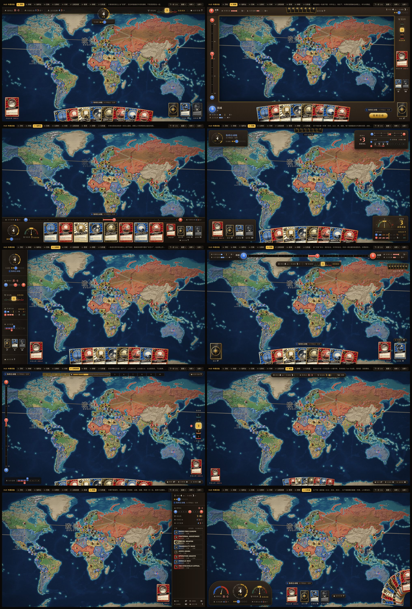
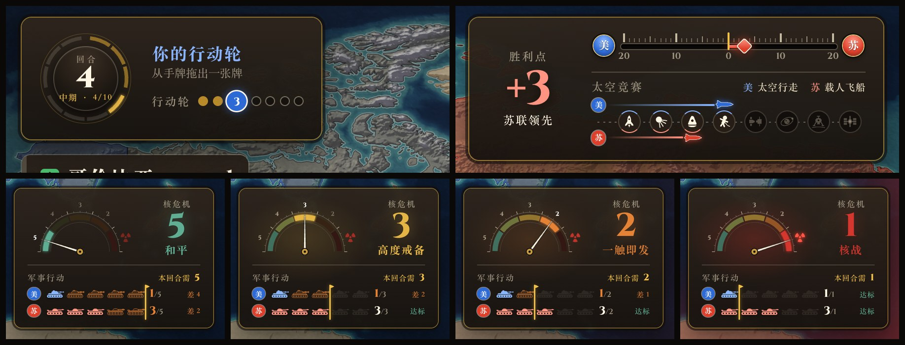

# HUD 布局实验

一个问题：**全局信息和牌，分别放在哪里？** 十个布局，同一张实时地图、同一份假局面、同一手牌，
按 `1`–`9`、`0` 即时切换，只比较“摆放”。



## 选定：04 四角

十个里选了 04。页面现在默认打开它，它的刻度也重画了一遍：每个刻度画成它代表的东西，而不是一排格子。

**04 已经合并进游戏**：模块在 `src/hud/`，对局页是 http://localhost:5173/game.html 。这个文件夹留作另外九个方案的对照；
之后要改 HUD，改 `src/hud/`，不要改这里。



| 刻度 | 画成什么 | 怎么读 |
|---|---|---|
| 核危机 | 一块指针表，刻度从 5 排到 1，末端是辐射标志 | 越危险弧上亮得越多、越红；到 2 级指针开始抽动、屏幕边缘泛红，到 1 级常亮 |
| 军事行动 | 每一点是一辆坦克，两方的坦克轮廓不同 | 金线是本回合需求（等于核危机等级，所以两者放在同一块里）；金线左边的空心坦克是还欠的 |
| 太空竞赛 | 两枚火箭沿八个里程碑飞：探空火箭、人造卫星、载人飞船、太空行走、轨道对接、绕月飞行、载人登月、空间站 | 上面蓝色是美国，下面红色是苏联；到过的里程碑亮起，圆圈上沿 / 下沿带上到达方的颜色 |
| 胜利点 | 一把刻度尺，中间是零 | 游标滑向领先的一方，左边的大数字是领先多少 |
| 回合 | 十段绕一圈，时期交界处留缺口 | 亮的一段是当前回合 |

**点任意一个刻度，它会走到下一个状态**（核危机降一级、坦克加一辆、火箭进一步……），只是为了看全每个刻度的所有样子，背后没有规则。
核危机 1 级只能这样点出来，“下一步”不会把它推到 1。

悬停国家时左上角的信息卡也换成了两行的简洁版：名字、稳定度、谁控制、双方影响力。相邻国家的列表去掉了，
因为悬停时地图本身已经把不相邻的节点压暗。这张卡是原型自己画的（`brief.js`），地图模块自带的那张在这个页面里被隐藏，
`src/map` 没有改；要用到游戏里时再把它搬进去。

## 怎么看

```sh
npm run dev
# 打开 http://localhost:5173/prototypes/hud-layouts/
```

需要开发服务器，因为它直接引用 `src/map` 的地图模块（只读，游戏代码不依赖这里的任何东西）。

| 操作 | 作用 |
|---|---|
| `1`–`9`、`0`，或 `←` `→` | 切换布局 |
| `空格` | 下一步：对手出一张牌，推进一个行动轮（各刻度会跟着动） |
| `R` | 重置局面 |
| `N` | 当前布局的说明：东西在哪、好处、代价 |
| `F` | 隐藏顶部这条工具栏，只看游戏画面 |
| 悬停手牌 | 放大到可读 |
| 把手牌拖出去再松手 | 打出：牌飞到“本轮出牌”，上一张进弃牌堆或废牌堆，对手随后回应 |
| 点 04 的任意刻度 | 走到它的下一个状态（演示） |
| 点牌库 | 抽一张（演示） |
| 点弃牌堆 / 废牌堆 | 翻看里面的牌 |

`?v=3` 直接打开第 3 个，`&clean=1` 不带工具栏，`&notes=1` 打开说明，`?v=8&board=1` 打开极简布局的态势板。

顶部那条深色工具栏是原型自己的，不属于任何 HUD。

## 十个布局

| # | 名字 | 参考 | 刻度按什么组织 | 手牌 | 牌堆 |
|---|---|---|---|---|---|
| 01 | 顶栏 | 文明 | 一条顶栏：左边是“资源”（胜利点、军事行动、太空），正中是回合徽章，右边是核危机 | 底部扇形 | 右下三叠 |
| 02 | 牌桌 | 炉石传说 | 地图嵌在桌框里：对手在上框、我在下框，共用刻度在左右框 | 下框扇形，上框有对手牌背 | 右框 |
| 03 | 指挥台 | 即时战略的底部面板 | 全部收进底部一块实心面板，胜利点是面板顶边的长条 | 面板里一张张立着，不重叠 | 面板右翼 |
| **04** | **四角（选定）** | 文明 VI | 四个角各一个主题：时间、比分、牌、威胁；刻度是画出来的 | 底部扇形 | 左下角 |
| 05 | 左侧栏 | 桌游数字版的状态栏 | 一条竖栏从上到下排七格 | 底部（让开侧栏居中） | 侧栏底部 |
| 06 | 对峙 | 格斗游戏的血条 | 按归属：我的在左上、对手的在右上，中间一根胜利点拉锯条 | 底部扇形 | 牌库左下、弃牌右下 |
| 07 | 边框刻度 | 取景器 / 飞行 HUD | 四条屏幕边各是一把尺：上时间、左比分、右危机 | 平时只露一条，靠近才升起 | 右下三个计数 |
| 08 | 极简 | 按需展开 | 常驻只有一行状态，其余按住 `Tab` 在态势板里看 | 平时半大小，靠近才展开 | 右下三个计数 |
| 09 | 牌册 | 把手牌当清单 | 右侧一列：读数在上，手牌清单在中 | 清单，悬停弹出整张牌 | 列底部 |
| 10 | 仪表盘 | 驾驶舱 | 左下角三个表盘：比分、回合、危机 | 绕右下角展开的握牌 | 底部正中一排 |

每个布局的完整位置表和取舍在页面里按 `N` 看，也写在各自的 `layouts/NN-*.js` 开头。

## 做的过程中确认的一件事：地图自带安全区

地图是 16:9，全景时永远铺满屏幕，所以任何 HUD 都压在地图上。但节点只占中间一块：

- **顶部 15%、底部 25%、左边 17%、右边 13%** 在全景时一个节点都没有（北冰洋、南大洋、太平洋）。
- 东西方向可以无限平移，南北方向到地图边缘为止。所以**底部**的 HUD 只要不超过 25% 屏高，
  任何缩放下都能把最南的节点（阿根廷、南非）拖到它上方；顶部同理，上限约 15%。

十个布局基本都在这个预算里。例外：02 牌桌和 09 牌册的面板是实心的，所以让地图缩进去了。

## 我的看法（选定之前写的）

最后选的是 04。下面是当时我的排序，留作记录。按“先保地图沉浸感，再保关键信息一眼可读”来排：

- **06 对峙** 最适合做主干。胜利点是这个游戏里唯一一个双方共用、此消彼长的数，画成一根拉锯条比
  任何数字都直接；按“我的 / 对手的 / 共用的”分区也最贴合两人对抗。牌的流向（牌库在左 → 出牌 →
  弃牌在右）也只有它讲清楚了。
- **07 的时间轴** 值得换进去：十个回合、三个时期、七个行动轮在同一条线上，比徽章 + 圆点信息量大。
- **08 的第二层** 可以叠在任何方案上：军事行动、太空竞赛不是每一步都要看的，常驻的可以更少。
- **03 的牌槽** 是扇形之外最值得试的手牌形式：不重叠，八张牌的标题同时可读。代价是底部最重。
- 02 牌桌如你所料，沉浸感最弱；但“对手牌背 + 结束行动按钮”让它最像一局牌，这两样可以单独借走。

这只是我的判断，哪个顺手要你上手拖几张牌才知道。

## 哪些是真的，哪些是占位

- **地图** 是游戏里那张，实时渲染，能拖能缩放能悬停；局面是沙盒的 demo 预设。
- **牌** 是 `prototypes/card-designs/deck/` 里那 81 张（01 Red Enamel 牌框），牌面文字跟着那边走（那边加了中文牌面之后这里也是中文）。
- **局面** 是 `state.js` 里编的一个瞬间：第 4 回合第 3 行动轮，苏联领先 3 分。
- **没有规则。** “下一步”和出牌只是把牌在几个牌堆之间挪动、给各刻度一个随机的小变化，
  为的是能看到每个元素动起来。出牌之后选“事件还是行动”、放影响力这些都没做。
- **各条轨道的长度**（十回合、七行动轮、±20、五级、八步……）集中在 `state.js` 的 `RULES` 里，
  是数据不是布局。太空竞赛的八步现在有名字和图标（`glyphs.js`），每一步值什么还没定。
- 军事行动的“本回合需求 = 当前核危机等级”是唯一画进 HUD 的规则关系（07 把两者画在了同一把尺上）。

## 文件

```
index.html            页面：地图 + HUD + 工具栏
main.js               入口：切换布局、工具栏、快捷键
mapdemo.js            加载 src/map 的地图并填入 demo 局面
state.js              假局面和几个“动作”（出牌、下一步、抽牌、重置）
widgets.js            HUD 的零件，每个零件有几种形态（见文件开头的表）
fine.js / fine.css    精细形态：核危机表、坦克条、太空轨道、胜利点刻度尺、回合圈（04 在用）
glyphs.js             坦克、火箭、八个太空里程碑的小图标
brief.js / brief.css  两行的国家信息卡，代替地图自带的那张
hand.js               手牌：扇形 / 平铺 / 隐藏 / 绕角 / 清单，悬停放大，拖出打出
cards.js              用 card-designs 的牌框生成牌面；牌飞行的小动画
icons.js              刻度用的小图标
hud.css               所有零件的样子（布局的 CSS 只管位置）
layouts/NN-name.js    一个布局 = 说明 + 手牌参数 + 一段带占位符的 HTML
layouts/NN-name.css   这个布局里每样东西放哪
shots/                十张截图和一张总览
```

一个布局就是一段 HTML，里面的占位符由 `widgets.js` 填充并随状态更新：

```html
<div data-w="vp" data-form="bar" data-scale></div>     <!-- 胜利点拉锯条，带刻度数字 -->
<div data-w="crisis" data-form="gauge"></div>          <!-- 核危机指针表（精细形态） -->
<div data-w="pile" data-kind="discard"></div>          <!-- 弃牌堆 -->
<div data-hand></div>                                  <!-- 手牌的基准点 -->
```

要加第十一个：复制一对 `layouts/` 文件，改 `id`，在 `layouts/index.js` 里登记。要混搭两个方案，
把一个布局的 HTML 片段和对应几行 CSS 挪到另一个里就行。

尺寸单位：`1rem` 在 1600×900 的游戏画面上是 10px，随窗口等比缩放。零件内部全用 `em`，
所以布局可以用 `font-size` 整体放大缩小一个零件。
