# 持续效果实验

一个问题：**一张事件牌打出后还在持续生效，它应该待在哪、长什么样？**

现在的对局里，这样的牌一打出就进了牌堆（或直接移出游戏），效果在不在只能靠记。这里换一种处理：牌打出后不进牌堆，而是作为「生效中」的被动效果显示在场上，直到它被取消或者到期，才按这张牌本来的去向离场：一次性事件移出游戏，其余进弃牌堆。

十个方案，同一张实时地图、同一个 HUD（主干的 `src/hud`，四角）、同一手牌、同一段剧本，只比较五件事：

1. **放在哪**：屏幕上哪一块归它。
2. **一眼看到什么**：不悬停时能知道多少（有几个、谁的、叫什么、什么时候结束、管哪里）。
3. **进场**：牌从桌面去到它的位置，这一步要看得见。
4. **触发**：被动效果真的做了事的时候，指给你看。
5. **离场**：被取消 / 期满 / 条件达成，说明原因，牌飞进它该去的牌堆。

指向任何一个生效中的事件，十个方案出的是同一张详情：读得清的牌面，加上牌面自己说不了的三件事（还持续多久、作用于哪里、结束后去哪个牌堆），同时地图上点亮它管的国家（复用地图自己的高亮）、HUD 上点亮它管的仪表或手牌。

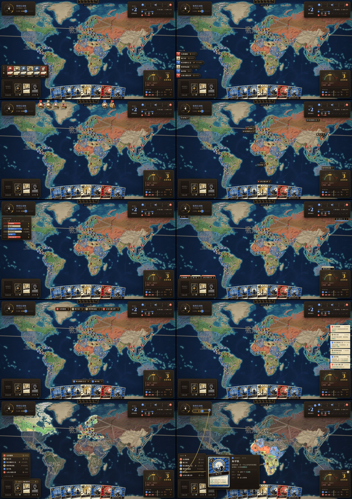

## 打开

开发服务器开着时：<http://localhost:5173/prototypes/passive-effects/>

| 键 | 作用 |
|---|---|
| `1`…`9`、`0`，或 `←` `→` | 切换方案 |
| `空格` | 演出剧本的下一步（演出中再按：这一步立刻演完，接着演下一步） |
| `R` | 回到开头 |
| `P` | 速度：常速 / 快 / 慢 |
| `N` | 这个方案的说明（五件事、好处、代价） |
| `F` | 隐藏工具栏 |
| `E` | 方案 09：摊开 / 收起 |

工具栏上的圆点 1–7 可以直接跳到剧本的任意一步之后。第一步也可以真的做：把手牌里的《和平队》拖出来松手。

地址参数：`?v=3`（方案）、`&at=2`（开局时前两步已经演完）、`&clean=1`（无工具栏）、`&pace=0.5`、`&hover=peace`（固定显示某个事件的详情，用于截图）、`&notes=1`。

## 剧本

开局时已有四个事件在生效，随后七步，把每一种进场、触发和离场各演一遍：

| 步 | 发生什么 | 看的是 |
|---|---|---|
| 开局 | 《兄弟援助》《板门店》《哈尔斯坦主义》《暂停核试验》已在生效 | 常驻的样子 |
| 1 | 你打出《和平队》（倒数 3 个行动轮） | 我方进场 |
| 2 | 对手打出《五角大楼文件》（本回合） | 对手进场 |
| 3 | 行动轮结束，《和平队》触发：非洲一国 +1 | 触发、倒数 3 → 2 |
| 4 | 对手打出《东方政策》，取消《哈尔斯坦主义》 | 被牌取消 → 移出游戏 |
| 5 | 对手发动政变，《暂停核试验》终止 | 条件达成 → 弃牌堆 |
| 6 | 又过两轮，《和平队》触发两次后期满 | 倒数到 0 → 弃牌堆 |
| 7 | 回合结束，三个「本回合」事件一起离场 | 多个同时到期 |

六个事件覆盖了四种「什么时候结束」和四种「管哪里」：

| 事件 | 结束于 | 作用于 | 去向 |
|---|---|---|---|
| 兄弟援助（苏） | 本回合结束 | 欧洲全境 | 弃牌堆 |
| 板门店（中立） | 本回合结束 | 朝鲜、韩国两国 | 移出游戏 |
| 哈尔斯坦主义（美） | 被《东方政策》取消 | 欧洲 + 分数 | 移出游戏 |
| 暂停核试验（中立） | 任一方发动政变 | 紧张度 | 弃牌堆 |
| 和平队（美） | 3 个行动轮后 | 非洲 + 每轮触发 | 弃牌堆 |
| 五角大楼文件（苏） | 本回合结束 | 你的手牌 | 移出游戏 |

**关于这些牌。** 页面用的是原创牌组（`prototypes/card-designs/deck`），和之前的打牌实验一样。那副牌里带持续条款的只有八张「本轮内……」，没有别的结束方式，所以这里另写了五张只属于这个页面的样本牌（`core/sample-cards.js`，编号 S01–S05：哈尔斯坦主义、东方政策、暂停核试验、和平队、五角大楼文件），用来把「被另一张牌取消」「满足条件才结束」「倒数几轮」这几种情况演出来。它们是真实事件、自己写的效果，没有平衡过，不在 81 张之内。

## 十个方案

每个方案两张图：常驻（六个事件同时生效）和悬停。

### 01 生效区　<small>牌桌上的第四个位置</small>

| 常驻 | 悬停 |
|---|---|
| 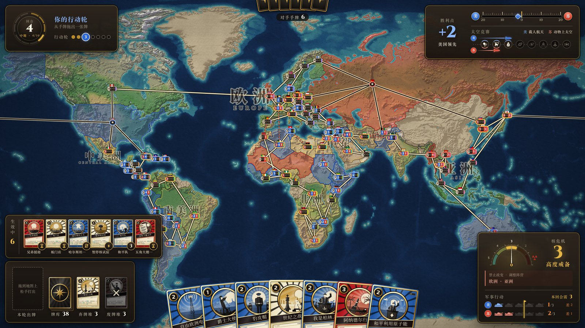 | 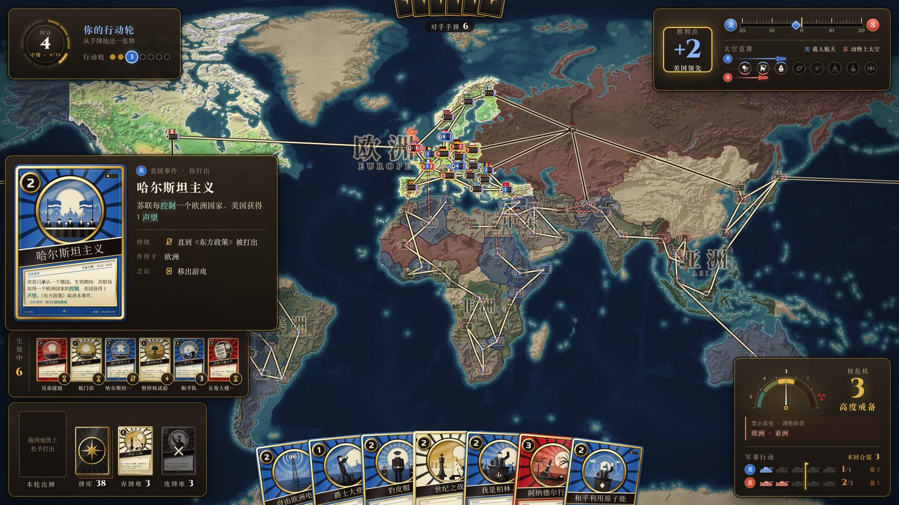 |

卡牌角多一层搁板：生效的牌以牌本身立在牌堆上方，右下角一枚小印说明何时结束（沙漏 = 本回合，数字 = 还剩几轮，带斜杠的牌 = 等一张牌，闪电 = 等一件事）。结束时牌面盖章，落进旁边的牌堆。

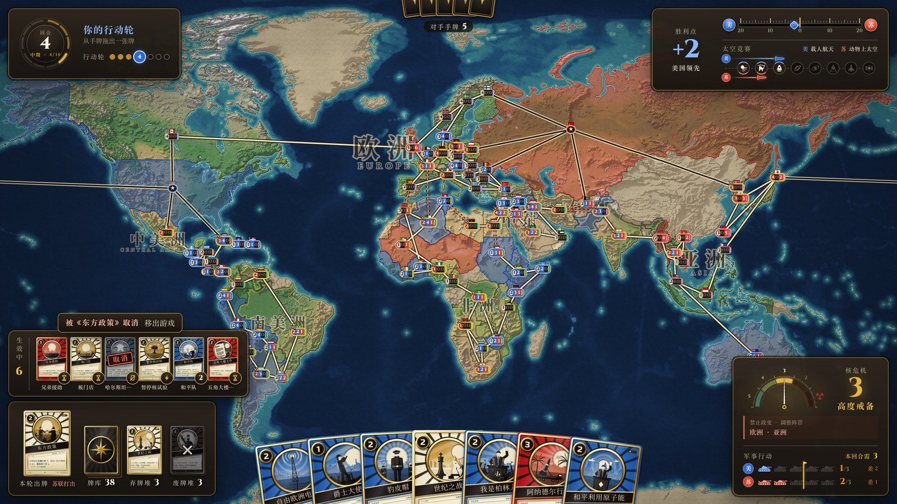

- **好处**：最直接地回答「这张牌现在在哪」，桌面 → 生效区 → 牌堆是一条看得见的线；不新造符号；离牌堆最近，离场那一下最好懂。
- **代价**：效果内容要悬停；超过五张会挤；只说「有什么」，「管哪里」靠悬停时点亮地图。

### 02 档案签　<small>文件柜里露出的索引签</small>

| 常驻 | 悬停 |
|---|---|
| 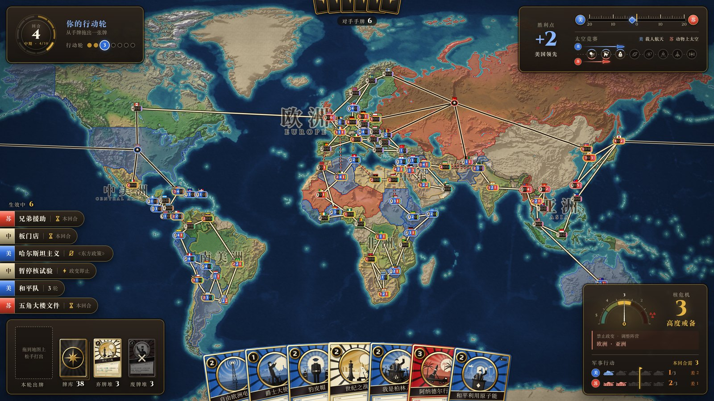 | 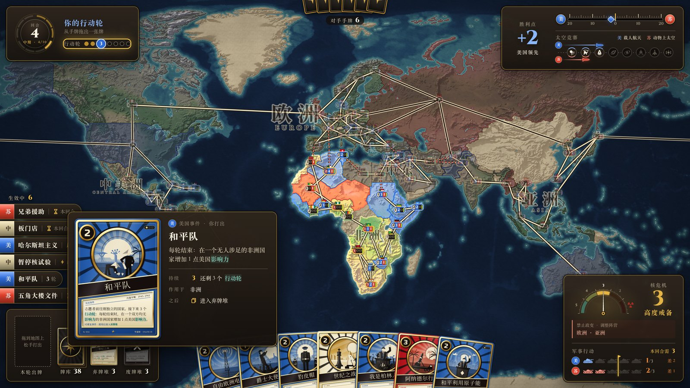 |

屏幕左缘伸出一排索引签：阵营色的签头、牌名、何时结束。进场时牌被收进屏幕边缘，签滑出来；离场时签退回去。

- **好处**：名字和期限不用悬停就读得出；常驻清单里占地最小的；六七个也不挤。
- **代价**：看不到牌面；国家卡片也在左边，签只能待在它下面。

### 03 勋章　<small>挂在上缘的一排勋章</small>

| 常驻 | 悬停 |
|---|---|
|  | 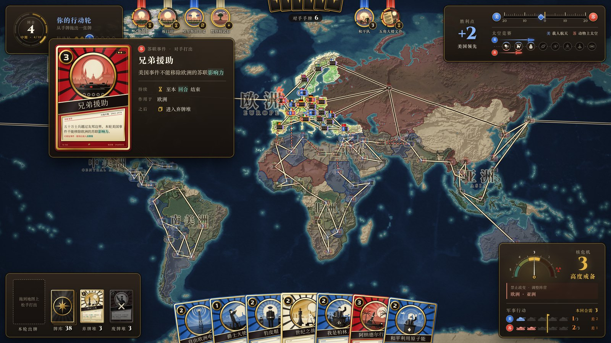 |

每个事件是一枚挂在屏幕上缘的勋章：绶带是阵营色，圆章是牌的画面，外圈是它的钟。会随时间结束的，外圈分格、一格一格熄灭；要等一张牌或一件事的，外圈是完整的一圈。进场时带着绶带落下来晃两下。

- **好处**：「还剩多久」是画出来的；密度高；和时间角同在上方。
- **代价**：小圆章要认熟了才认得出；离卡牌角最远，飞行路程长。

### 04 就地标记　<small>哪里受影响，标记就在哪里</small>

| 常驻 | 悬停 |
|---|---|
|  | 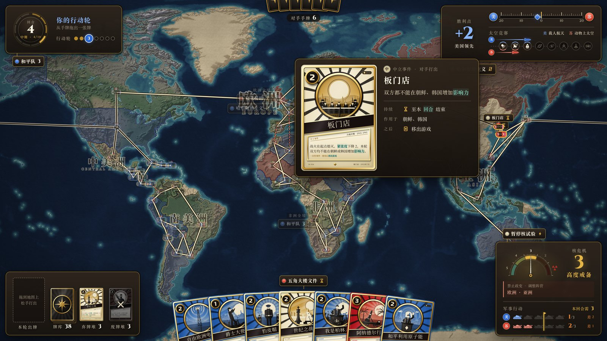 |

不设清单。事件管哪里，标记就挂在哪里：地区旁一面旗（「欧洲全境」）、国家上一面小旗、仪表上一枚挂签、手牌上方一枚挂签。一个事件可以同时出现在几处，进场时依次立起来。

- **好处**：做决定时不用查表，要在哪里行动，那里就写着限制；「它管什么」不需要悬停。
- **代价**：没有总数，也没有一处能看全；地图上多了东西，会和节点抢视线；旗子跟着地图跑。

### 05 有效期　<small>时间角下面的一张日程</small>

| 常驻 | 悬停 |
|---|---|
| 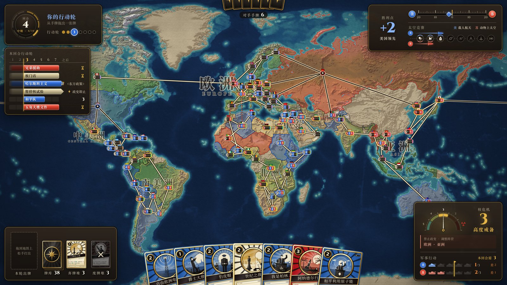 | 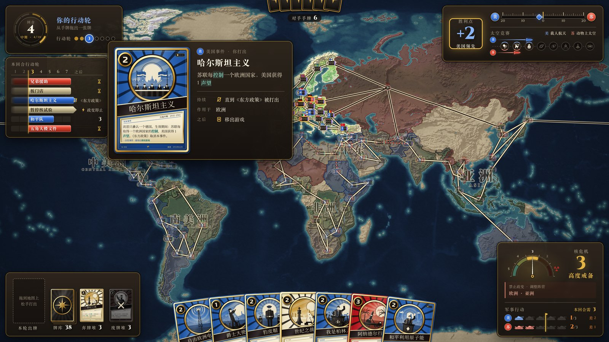 |

时间角下面挂一张本回合行动轮的刻度，每个事件一条横杠：从哪轮开始，到哪轮结束；要等一张牌或一件事的，横杠伸出刻度并写着等什么。金色竖线是现在，过去的部分变暗；触发过的那一轮留一枚小菱形。

- **好处**：唯一把「什么时候结束」画成几何的，到期顺序一目了然；触发留痕。
- **代价**：最占地方，而且占的是国家卡片的位置；不说「管哪里」。

### 06 压角　<small>把牌压在它管的那条刻度旁边</small>

| 常驻 | 悬停 |
|---|---|
| 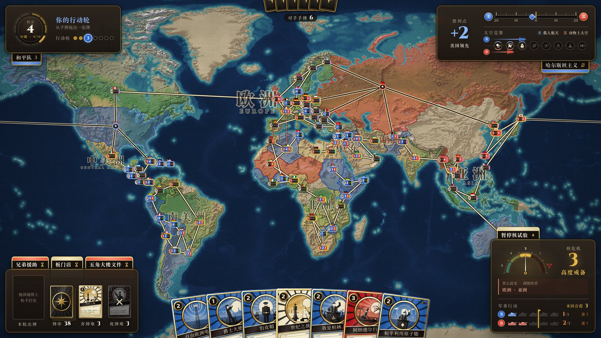 | 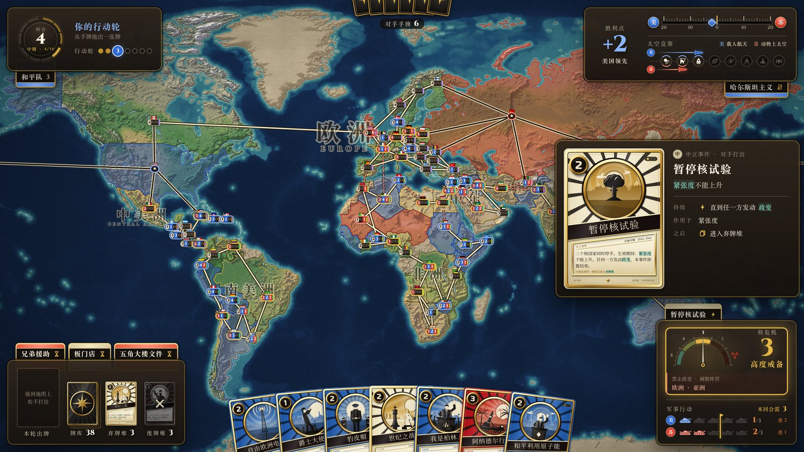 |

像真实桌面那样，把生效的牌压在相关的那个角下面，只露出牌头：管紧张度的压在威胁角，给分的压在分数角，按轮次触发的压在时间角，其余压在卡牌角。指上去那一截抽出来。

- **好处**：位置本身带信息；分成四处，每处只有一两张；桌游玩家一看就懂。
- **代价**：要记住四个角各管什么；没有总数；按地区生效的事件没有自己的角，只能回到卡牌角。

### 07 对坐　<small>谁打出的，就立在谁面前</small>

| 常驻 | 悬停 |
|---|---|
| 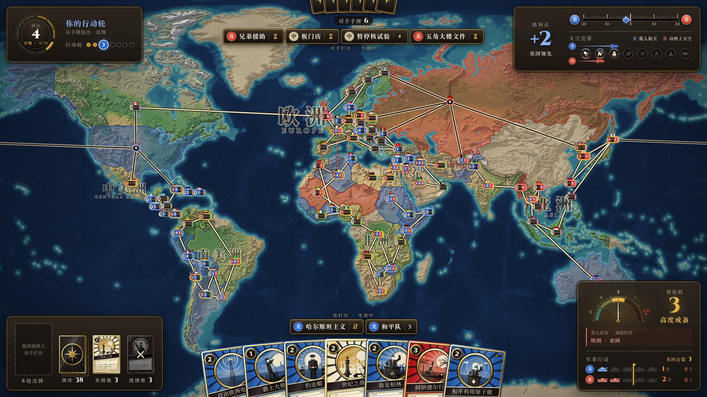 | 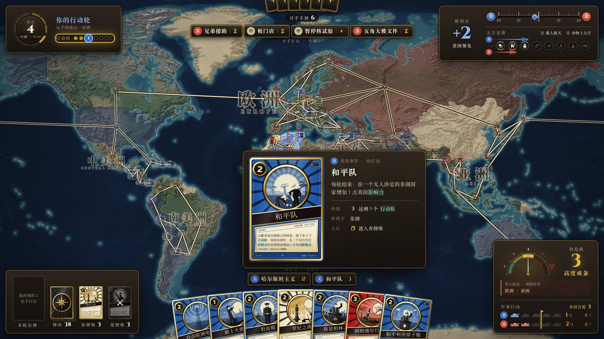 |

两排名牌：你打出的立在你手牌上方，对手打出的立在对手手牌下方，上下对称。

- **好处**：「这是谁干的」不用读；和对手出牌的对称演出是同一套语言；离手牌最近。
- **代价**：「谁打出的」和「对谁有利」不总是一回事；占了手牌上方的地图下缘。

### 08 常设指令　<small>夹在板边的一叠纸条</small>

| 常驻 | 悬停 |
|---|---|
| 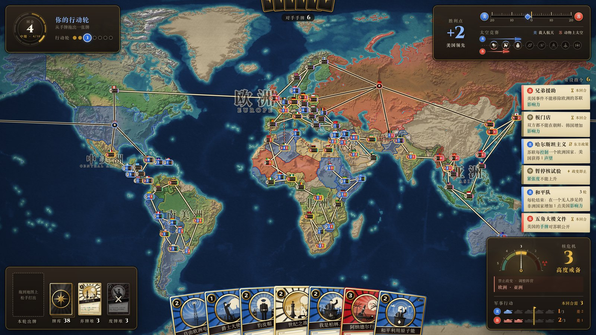 | 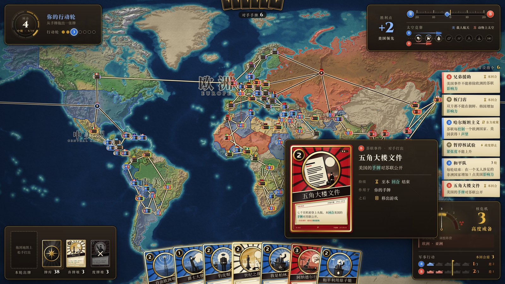 |

右缘夹着一叠纸条，一张一个事件，下面直接写着它做什么，规则术语照卡牌的方式高亮。离场时在纸上盖红章、撕走。

- **好处**：唯一不用悬停就能读到效果内容的；对新手最友好；章盖在纸上，原因看得清。
- **代价**：字最多、最抢眼；六张就占掉右缘大半；牌进出要横穿屏幕。

### 09 一枚印　<small>平时只留一行，要看再展开</small>

| 常驻 | 悬停 | 摊开（E） |
|---|---|---|
| 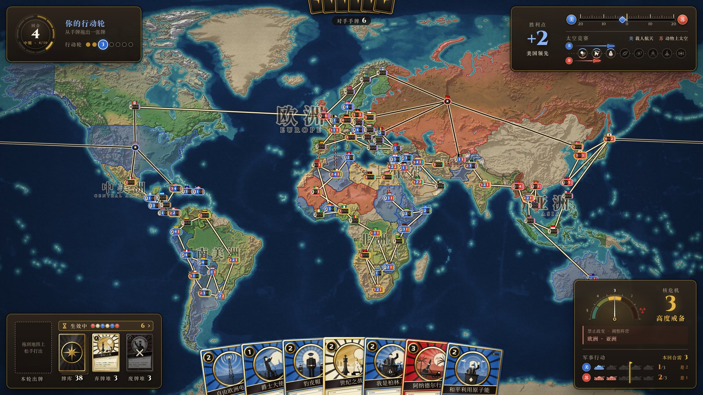 | 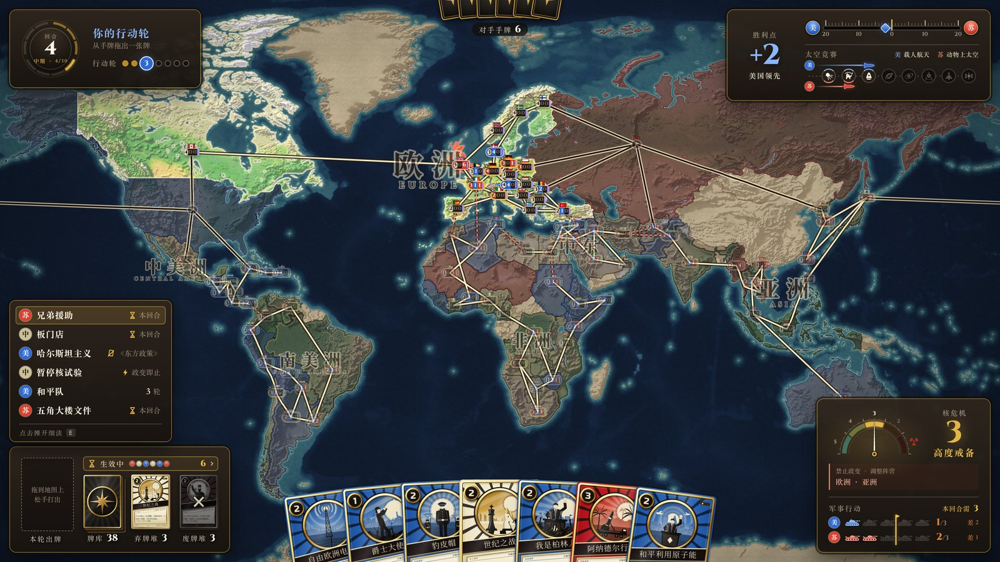 | 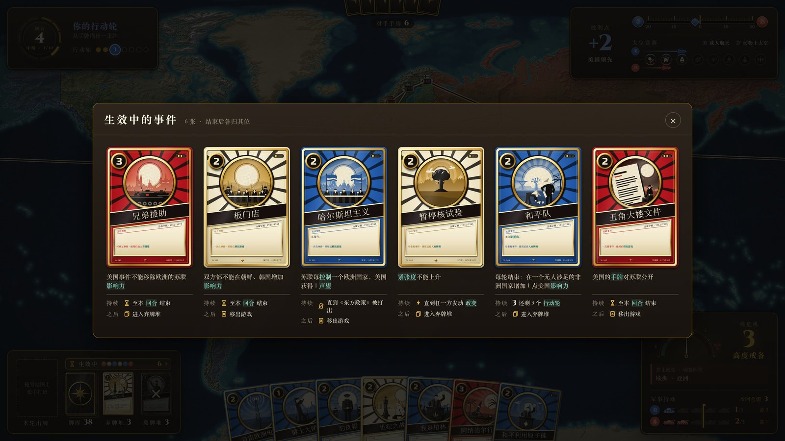 |

卡牌角里只多一行「生效中 6」和几粒阵营色的点。指上去出清单（指某一行，地图点亮它管的地方）；点开把牌摊开细读，每张带效果、期限和去向。进场、触发、离场时由这一行开口说话。

- **好处**：地图最干净；摊开时每张都是能读的大小；和「查看弃牌堆」是同一种窗口。
- **代价**：平时只有数字和颜色；每次确认多一步；过场提示错过了就没了。

### 10 连线　<small>图例 + 编号 + 一根线</small>

| 常驻 | 悬停 |
|---|---|
| 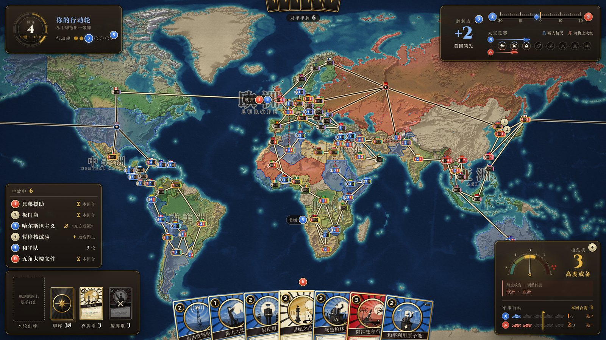 | 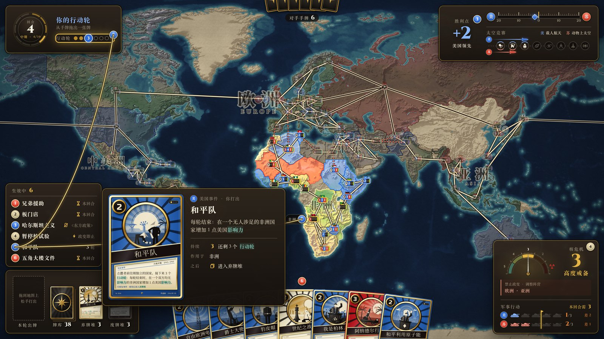 |

卡牌角上方一张编号的图例；同样编号的小圆片放在它管的地方（地区、国家、仪表、手牌）。指任何一头，拉出一根线把两头连起来。进场时线从图例伸到每一处、圆片在线头落下；触发时线射向这次作用的国家。


- **好处**：清单和「就地」两种看法都有，而且互相指得到；地图上的负担最小；线本身就是「指给你看」。
- **代价**：要学编号这层对应；零件最多，做进主干最费事。

## 我的看法

- **01 生效区**是最稳的底：它回答的正是「牌现在在哪、最后去哪」，而且只动卡牌角。
- 它缺的是「管哪里」。**10** 的编号圆片可以单独借过来补这一块，地图上只多几枚小圆点。
- 如果更想要桌面感，**06 压角**是最有性格的一个，但它要求玩家记住四个角的分工。
- **04** 和 **08** 各走一个极端（全在地图上 / 全写成字），适合拿来确认你对「地图上能放多少东西」「常驻文字能有多少」的底线。

## 并入主干需要什么

显示层只要一份「生效中」的清单，和 HUD 的其它部分一样不算规则：

```ts
type InForce = {
  card: string;                 // 牌的 id；牌面和去向（弃牌堆 / 移出游戏）由牌决定
  by: SideIndex;                // 谁打出的
  since: { turn: number; round: number };
  until:                        // 什么会结束它
    | { kind: 'turn' }
    | { kind: 'rounds'; left: number; of: number }
    | { kind: 'card'; card: string }
    | { kind: 'condition'; text: Localized };
  scope: { countries?: string[]; region?: string; meter?: Meter | 'rounds'; hand?: SideIndex };
  line: Localized;              // 一句话的效果
};
```

规则一侧要改的只有一处：持续事件打出后，牌留在这份清单里，不进 `discard` / `removed`；结束时再放进去，并说明原因（取消 / 期满 / 条件达成），演出层据此盖章和飞牌。选定方案后按这个接口并入 `src/hud`，不会碰牌表和规则本身。

## 文件

```
index.html            页面；载入原创牌组和五张样本牌
main.js               舞台：地图 + 主干 HUD + 工具栏 + 方案装载
core/effects.js       六个事件的定义、剧本（七步）
core/stage.js         把剧本一步步演出来；方案可以接管 进场 / 触发 / 离场
core/detail.js        共用的悬停详情，以及点亮地图 / 仪表 / 手牌
core/fx.js            飞牌、提示、盖章、图标
core/core.css         共用样式
variants/NN-*.js|css  十个方案，各自独立，按需载入
```

写一个新方案只需要 `mount(ctx)` 返回 `sync(list)` 和 `el(id)`：把清单画出来，并说出哪个元素代表哪个事件。给元素加上 `data-fx="<id>"` 就自动得到悬停详情。
