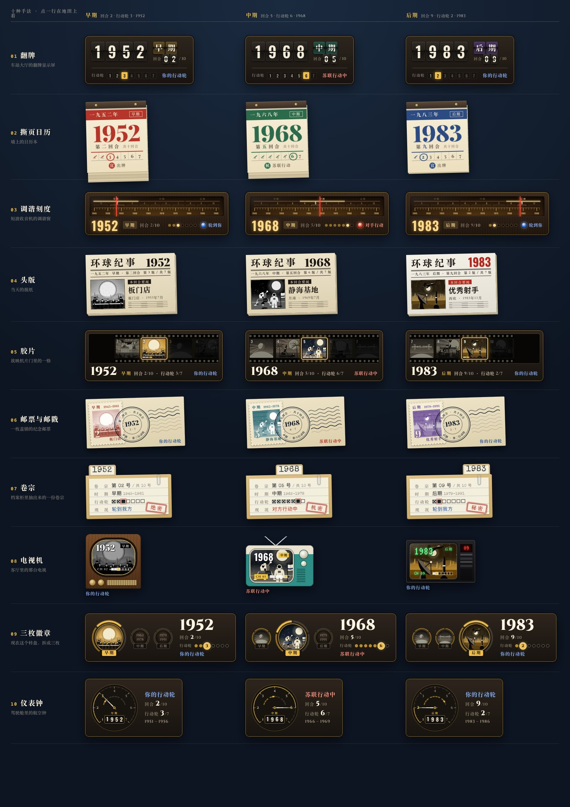
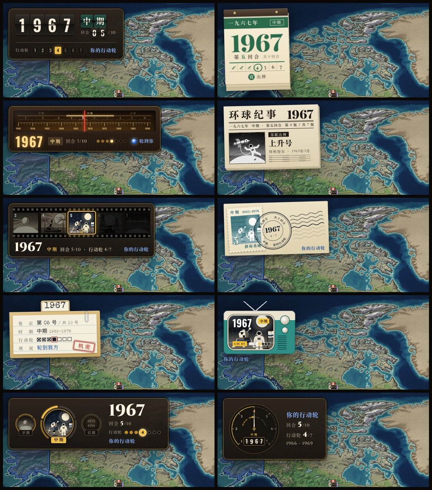

# 年份显示实验

一个问题：**左上角那个回合转盘，怎么换成更有代入感的“现在是哪一年”？** 十种手法，舞台是
`prototypes/hud-layouts` 里选定的 04 四角布局（同一张实时地图、同一手牌），只换左上角这一块。



放到地图左上角的样子：



## 怎么看

```sh
npm run dev
# 打开 http://localhost:5173/prototypes/year-styles/
```

| 操作 | 作用 |
|---|---|
| `1`–`9`、`0`，或 `←` `→` | 换一种手法 |
| `空格` | 下一个行动轮（第七轮之后进入下一回合） |
| `]` / `[` | 下一回合 / 上一回合 |
| `S` | 换成对手行动 / 换回你 |
| `G` | 总览：十种一起看，各取早期、中期、后期的一年；点一行回到地图上看它 |
| `N` | 当前手法的说明：怎么读、好处、代价 |
| `F` | 隐藏顶部工具栏 |

`?v=3` 直接打开第 3 种，`?g=1` 打开总览，`?t=8&r=2` 从第 8 回合第 2 行动轮开始，`&clean=1` 不带工具栏。

换回合时每种手法都有自己的动作（翻牌、撕页、胶片走一格、换台……），所以值得按几下 `]` 看看。

## 十种手法

| # | 名字 | 像什么 | 年份在哪 | 时期怎么表现 | 回合 / 行动轮 |
|---|---|---|---|---|---|
| 01 | 翻牌 | 车站的翻牌显示屏 | 四块大翻牌 | 两块汉字翻牌，按时期换底色 | 小翻牌 / 一排七格 |
| 02 | 撕页日历 | 墙上的日历本 | 页面正中的大数字 | 页眉和数字的颜色：红、绿、蓝 | 换回合撕一页，纸边厚度是剩余回合 / 一周七格 |
| 03 | 调谐刻度 | 短波收音机的调谐窗 | 红针在 1945–1991 刻度上的位置 | 三个波段 | 十个台 / 七盏灯，红针每轮挪一点 |
| 04 | 头版 | 当天的报纸 | 报头 | 版式和照片：早中期黑白，后期彩色 | 日期栏 / 第几版 |
| 05 | 胶片 | 放映机片门里的一格 | 片门下的大数字 | 写在年份旁边 | 十格胶片，当前格在片门里 / 片门下沿七段 |
| 06 | 邮票与邮戳 | 一枚盖销的纪念邮票 | 邮戳正中 | 邮票的油墨颜色 | 面值 / 七道销票波纹 |
| 07 | 卷宗 | 档案柜里的一份卷宗 | 索引标签上的打字数字 | 标签靠左、居中、靠右；印章密级 | 卷宗编号 / 七个方框 |
| 08 | 电视机 | 客厅里的电视 | 画面上的字幕 | **电视机换代**：木壳黑白机 → 塑料壳带天线 → 黑色彩电 | 频道号 / 画面下沿七格 |
| 09 | 三枚徽章 | 现在的转盘拆成三枚 | 右边的大数字 | 三枚徽章，当前时期那枚放大 | 徽章外圈分段 / 一排点 |
| 10 | 仪表钟 | 驾驶舱里的航空钟 | 滚轮计数器 | 表盘上的字 | 上方小弧 / 长针 |

每种的读法和取舍在页面里按 `N` 看，也写在各自的 `variants/NN-*.js` 开头。

## 画面从哪来

04、05、06、08、09 里的小画**不是新画的，也不是生成的**：它们是 `prototypes/card-designs/deck/` 那套牌自己的插图。
牌本来就按年份排、每张有地点和日期，所以每个回合挑了一张那几年的牌，用它的画代表这个回合（`time.js` 里的 `EMBLEMS`）。
好处是和牌面是同一种画法，也不引入新的美术风格；坏处是尺寸小的时候细节看不清。

如果选中的手法值得配专门的画（比如胶片的十格、电视的画面、邮票），那时再去生成或绘制，这一步没有做。

## 几个我先定下、需要你确认的东西

- **回合对应哪几年。** 三个时期用的是牌库自己的划分（1945–1961、1962–1978、1979–1991），十个回合按 3 / 4 / 3 铺上去，
  一回合四到六年（表在 `time.js` 的 `SPANS`）。回合内年份随行动轮往前走。这是为了“显示年份”先编的，不是规则。
- **每个回合用哪张牌的画**（`EMBLEMS`）：空中桥梁、板门店、旅伴、阿纳德尔行动、静海基地、石油武器、轨道握手、二十一条要求、优秀射手、十一月九日。
- **报纸叫《环球纪事》**，是编的名字。

## 我的看法

- **09 三枚徽章** 换上去最不突兀：和牌面的金圈画框、和其它三个角的深色面板是同一种东西，同时三个时期各有一张脸。
- **05 胶片** 最接近“一排十格、看得见走到哪”的读法，而且每个回合有自己的画面。
- **02 撕页日历** 最有性格，年份也最好认；代价是它是一张亮色的纸，和其它三个角不是一种材质。
- 08 电视机是唯一真正做到“早、中、后期各长各的样”的，但也最花哨。10 仪表钟和核危机表是一套，但时代感最弱。

这只是我的判断。
